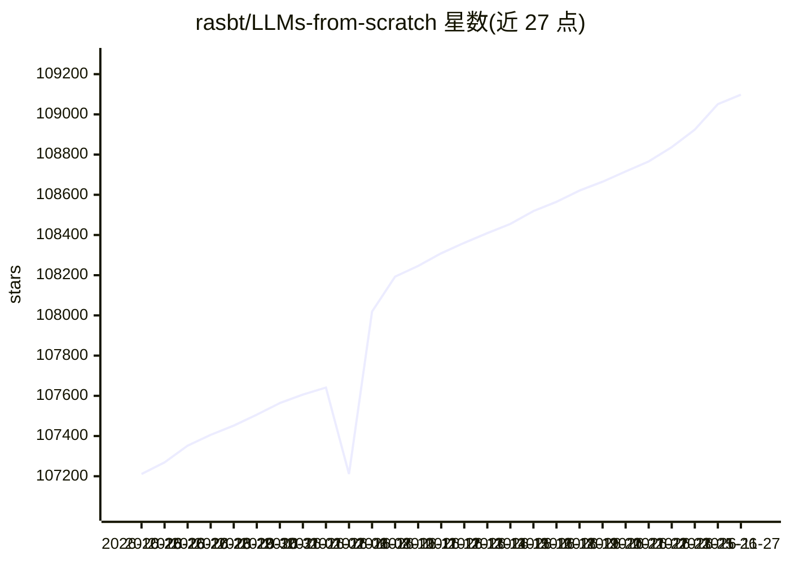

# rasbt/LLMs-from-scratch

⭐ 109,098 · Jupyter Notebook · NOASSERTION · 推送 2026-11-26 · [GitHub](https://github.com/rasbt/LLMs-from-scratch) · [官网](https://amzn.to/4fqvn0D) · 个人维护

**从零用 PyTorch 实现 GPT 类 LLM 的配套代码库（学习者用）**

这是 Manning 图书《Build a Large Language Model (From Scratch)》的官方代码仓库，内容覆盖从文本数据处理、注意力机制、GPT 模型实现，到预训练、分类微调与指令微调的完整流程，各章含练习解答 notebook 与 170 页自测 PDF。附加材料包括 KV Cache、MoE、DPO、多种现代架构（Llama 3.2/Qwen3/Gemma 3 等）复现、基于 OpenAI API 与 Ollama 的评估，以及 17 小时视频课程。代码只用 PyTorch 从零实现，不依赖外部 LLM 库，设计为可在普通笔记本上运行。

## 筛选速览

| 维度 | 判定 | 备注 |
|---|---|---|
| AI 角色 | `ai-knowledge` | 知识聚合/清单类 |
| 许可风险 | `none` | NOASSERTION |
| 部署形态 | `None` |  |
| 模型依赖 | local-ok | 支持本地模型 |
| 硬件要求 | — | 无带数字的原话,不猜 |
| 安装摩擦 | `low` | 无编译、无系统依赖或容器化 |
| 成熟度 | — | 结构信号不足 |

## 动量与使用信号

- 维护:`active` — 距上次 push 15.7 天,年发版 0,69 位贡献者
- 涨星:近 1 天 **+85**(自 20261016 起算)
- 平台:WINDOWS / MACOS / LINUX · 协议:OPENAI-API / OLLAMA

## 能力要点

- 从零实现 GPT 类模型：分词、注意力、预训练、指令微调全流程
- 附加材料覆盖 KV Cache、MoE、DPO、Llama/Qwen3/Gemma 等架构复现
- 各章练习解答 notebook 与 170 页自测 PDF
- 自动在有 GPU 时使用 GPU，无专用硬件要求

## 适用场景

- 想从代码层面理解 LLM 内部原理的学习路径
- 练习预训练与指令微调自己的小型模型
- 参考 bonus 材料复现 Qwen3、Gemma 等现代架构

## 场景标签

`教程课程` `微调` `模型训练` · 领域:学习与行业

## 证据(README 行号)

> L3: This repository contains the code for developing, pretraining, and finetuning a GPT-like LLM and is the official cod
> L5: In *Build a Large Language Model (From Scratch)*, you'll learn and understand how large language models (LLMs) work 
> L32: This book uses PyTorch to implement the code from scratch without using any external LLM libraries. While proficien

## 星数曲线

2026-10-25 107,211 → 2026-11-27 109,098（+1,887）

---
*卡片 v1 · prompt 1.4 · 生成 2026-11-22 · 置信度 high · 依据 README sha `420b21aa4f04` · [字段定义](../../DATASET.md)*
