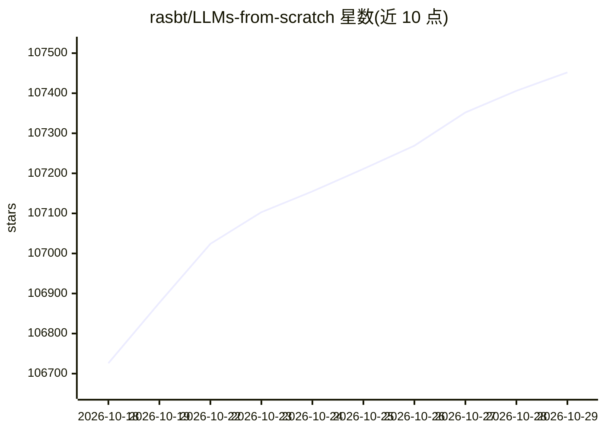

# rasbt/LLMs-from-scratch

⭐ 107,452 · Jupyter Notebook · NOASSERTION · 推送 2026-10-02 · [GitHub](https://github.com/rasbt/LLMs-from-scratch) · [官网](https://amzn.to/4fqvn0D) · 个人维护

**学习者/研究者：从零用 PyTorch 逐步实现类 GPT 大模型**

《Build a Large Language Model (From Scratch)》一书的官方代码仓库，按章节组织：用 PyTorch 从零实现、预训练与指令微调一个类 GPT 模型，不依赖外部 LLM 库。包含练习解答、附录材料（BPE 分词器、KV Cache、MoE、DPO 等扩展笔记）以及加载 Llama/Qwen/Gemma 等预训练权重进行微调的代码。配套 17 小时视频课程与 170 页测验 PDF。作者要求不提交偏离印刷书内容的主章节代码贡献。

## 筛选速览

| 维度 | 判定 | 备注 |
|---|---|---|
| AI 角色 | `ai-knowledge` | 知识聚合/清单类 |
| 许可风险 | `none` | NOASSERTION |
| 部署形态 | `None` |  |
| 模型依赖 | — | README 未给出锁定关系 |
| 硬件要求 | — | 无带数字的原话,不猜 |
| 安装摩擦 | `low` | 无编译、无系统依赖或容器化 |
| 成熟度 | — | 结构信号不足 |

## 动量与使用信号

- 维护:`active` — 距上次 push 15.7 天,年发版 0,69 位贡献者
- 涨星:近 1 天 **+85**(自 20261016 起算)
- 平台:WINDOWS / MACOS / LINUX · 协议:OPENAI-API / OLLAMA

## 能力要点

- 从零实现、预训练与指令微调类 GPT 模型，不使用外部 LLM 库
- 附加 Llama 3.2、Qwen3、Gemma 3 等模型的 From Scratch 实现与预训练权重加载
- 提供 Docker 环境搭建指南与 17 小时配套视频课程
- 包含 DPO 对齐与 RLVR/GRPO 等扩展材料

## 适用场景

- 系统学习 LLM 内部原理与实现细节
- 为自己的科研模型做分类/指令微调实验
- 在普通笔记本上复现 GPT 训练流程

## 场景标签

`教程课程` · 领域:学习与行业

## 证据(README 行号)

> L3: This repository contains the code for developing, pretraining, and finetuning a GPT-like LLM and is the official cod
> L32: This book uses PyTorch to implement the code from scratch without using any external LLM libraries. While proficien
> L38: The code in the main chapters of this book is designed to run on conventional laptops within a reasonable timeframe

## 星数曲线

2026-10-18 106,726 → 2026-10-29 107,452（+726）

---
*卡片 v1 · prompt 1.4 · 生成 2026-10-18 · 置信度 high · 依据 README sha `b342bec66cdb` · [字段定义](../../DATASET.md)*
