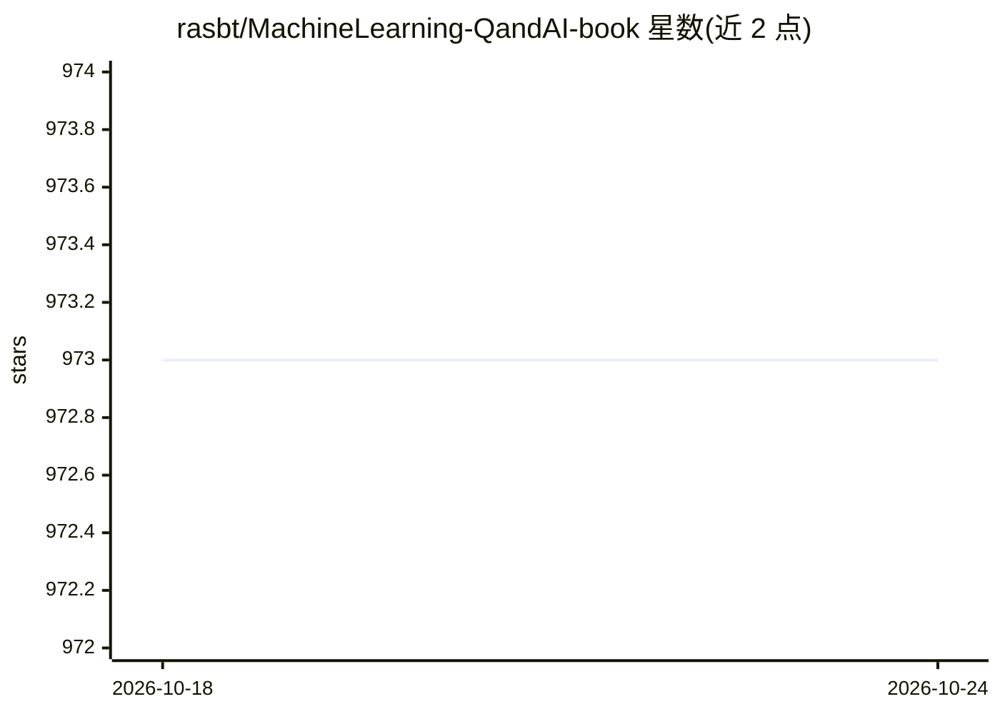

# rasbt/MachineLearning-QandAI-book

⭐ 973 · Jupyter Notebook · BSD-3-Clause · 推送 2025-12-17 · [GitHub](https://github.com/rasbt/MachineLearning-QandAI-book) · [官网](https://www.amazon.com/Machine-Learning-AI-Essential-Questions/dp/1718503768) · 个人维护

**机器学习书籍《Machine Learning Q and AI》的配套材料仓库**

Sebastian Raschka 所著《Machine Learning Q and AI Beyond the Basics》一书的补充材料仓库。该书以问答形式分短章回答机器学习与 AI 领域 30 个核心问题，配有图解与延伸阅读文献；话题包括多 GPU 训练范式、微调 transformers、编码器与解码器式 LLM 的差异、视觉 transformers 概念、机器学习置信区间等。本书是此前在 Leanpub 发布版本的完整编辑修订版，可通过 No Starch Press 与 Amazon 购买；仓库提供目录、补充材料链接，并通过 Discussions 支持读者提问。

## 筛选速览

| 维度 | 判定 | 备注 |
|---|---|---|
| AI 角色 | `ai-knowledge` | 知识聚合/清单类 |
| 许可风险 | `permissive` | BSD-3-Clause |
| 部署形态 | `None` |  |
| 模型依赖 | — | README 未给出锁定关系 |
| 硬件要求 | — | 无带数字的原话,不猜 |
| 安装摩擦 | `low` | 无编译、无系统依赖或容器化 |
| 成熟度 | — | 结构信号不足 |

## 能力要点

- 30 个机器学习/AI 核心问题的问答式章节
- 覆盖多 GPU 训练、transformers 微调、编码器/解码器 LLM 差异等话题
- 每章配图解与延伸阅读文献
- 为 Leanpub 版本的完整编辑修订版

## 适用场景

- 已掌握 ML 基础的读者查漏补缺
- 了解 transformers 与 LLM 相关核心概念
- 获取书中配套的补充材料并参与读者讨论

## 场景标签

`教程课程` · 领域:学习与行业

## 证据(README 行号)

> L3: The Supplementary Materials for the Machine Learning Q and AI book by Sebastian Raschka.
> L11: If you’ve locked down the basics of machine learning and AI and want a fun way to address lingering knowledge gaps,

## 星数曲线

2026-10-18 973 → 2026-10-24 973（+0）

---
*卡片 v1 · prompt 1.4 · 生成 2026-10-21 · 置信度 high · 依据 README sha `49b75dc2963e` · [字段定义](../../DATASET.md)*
