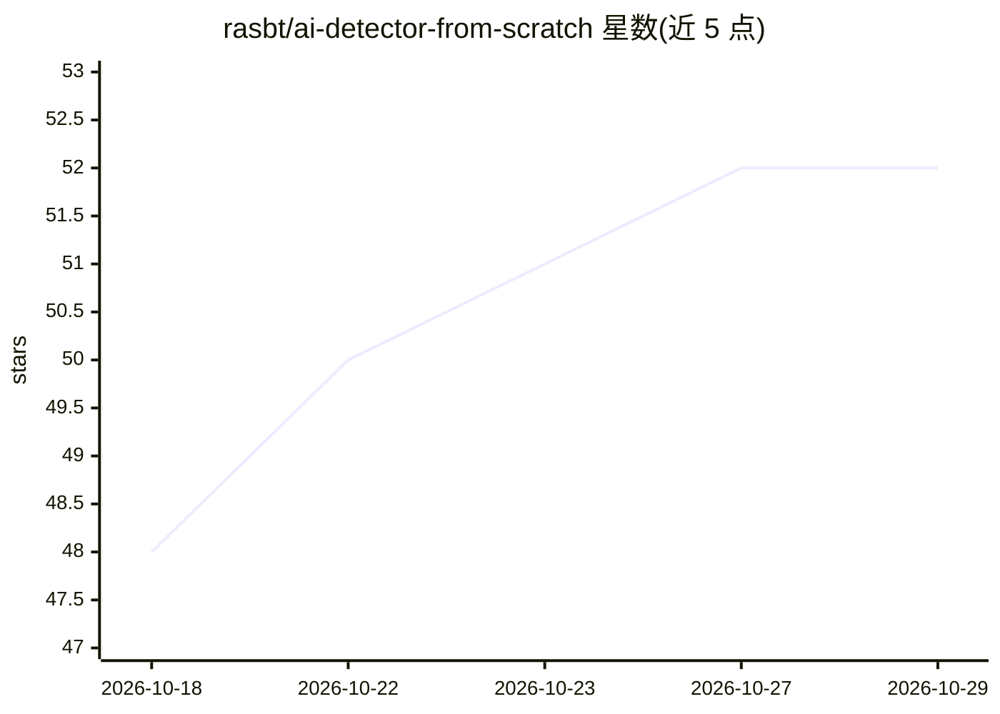

# rasbt/ai-detector-from-scratch

⭐ 52 · Jupyter Notebook · Apache-2.0 · 推送 2026-09-01 · [GitHub](https://github.com/rasbt/ai-detector-from-scratch) · [官网](https://magazine.sebastianraschka.com/p/ai-detector-from-scratch) · 个人维护

**从零构建 AI 文本检测器的端到端训练与推理项目**

配套文章的完整项目代码：从数据集构建（人类文本与 AI 生成文本各 25,355 篇）出发，比较逻辑回归、DistilBERT、ModernBERT、GPT-2、Qwen3 等多种分类器架构，并将检测器用作强化学习中的验证器。检测器输出 0-100 分，分数越高表示模型认为文本越可能由 AI 生成。提供 CLI 与本地 FastAPI+React 浏览器界面，训练产物托管于 Hugging Face Hub 可直接下载。使用 Python 3.12 与 uv 管理，部分训练需 CUDA GPU，数据生成脚本使用外部 API 或本地 Ollama。

## 筛选速览

| 维度 | 判定 | 备注 |
|---|---|---|
| AI 角色 | `ai-native` | 本体是模型或模型工具 |
| 许可风险 | `permissive` | Apache-2.0 |
| 部署形态 | `None` |  |
| 模型依赖 | local-ok | 支持本地模型 |
| 硬件要求 | — | 无带数字的原话,不猜 |
| 安装摩擦 | `medium` | 含编译或系统依赖之一 |
| 成熟度 | — | 结构信号不足 |

## 能力要点

- 二分类检测器输出 0-100 的 AI 生成可能性分数
- 覆盖 TF-IDF 逻辑回归到 Qwen3 微调的多种架构比较
- 本地 React + FastAPI 浏览器界面，支持 100-token 分块分析
- 将检测器用作强化学习验证器（RLVR）的实验

## 适用场景

- 我想检测一段文本是否可能由 AI 生成
- 我想复现或比较不同架构的 AI 文本检测器训练流程
- 我想在本地通过 CLI 或浏览器界面批量检查长文本的各部分 AI 倾向

## 场景标签

`微调` `模型训练` · 领域:训练与推理

## 证据(README 行号)

> L10: The detector is a binary classifier. Given a text, it returns a score from 0
> L104: The same interface supports the DistilBERT, ModernBERT, GPT-2, and Qwen3

## 星数曲线

2026-10-18 48 → 2026-10-29 52（+4）

---
*卡片 v1 · prompt 1.4 · 生成 2026-10-25 · 置信度 high · 依据 README sha `d1c0e4eddbf7` · [字段定义](../../DATASET.md)*
