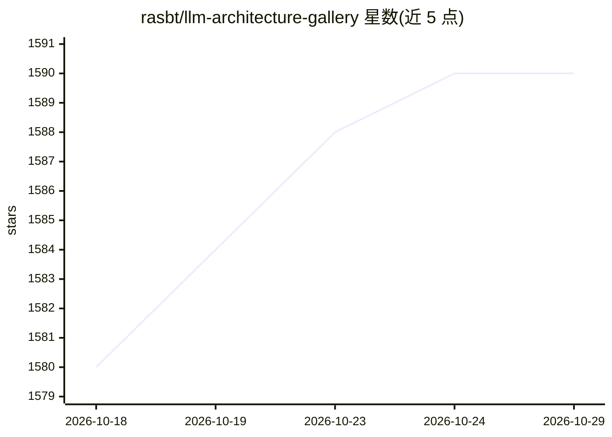

# rasbt/llm-architecture-gallery

⭐ 1,590 · Apache-2.0 · 推送 2026-10-04 · [GitHub](https://github.com/rasbt/llm-architecture-gallery) · [官网](https://sebastianraschka.com/llm-architecture-gallery/) · 个人维护

**LLM Architecture Gallery 的模型元数据源数据仓库**

存放 LLM Architecture Gallery（sebastianraschka.com 在线画廊）的源模型元数据。仓库定位为画廊元数据的轻量公开数据导出，而非完整网站实现；用户可通过该数据了解各 LLM 的架构信息，或在 Live gallery 中浏览。README 本身仅说明仓库用途与定位，未提供安装或使用命令。

## 筛选速览

| 维度 | 判定 | 备注 |
|---|---|---|
| AI 角色 | `ai-knowledge` | 知识聚合/清单类 |
| 许可风险 | `permissive` | Apache-2.0 |
| 部署形态 | `None` |  |
| 模型依赖 | — | README 未给出锁定关系 |
| 硬件要求 | — | 无带数字的原话,不猜 |
| 安装摩擦 | `low` | 无编译、无系统依赖或容器化 |
| 成熟度 | — | 结构信号不足 |

## 能力要点

- 提供画廊源模型元数据的公开数据导出
- 配套在线画廊 sebastianraschka.com/llm-architecture-gallery
- 定位为轻量数据导出，不含完整网站实现

## 适用场景

- 获取各 LLM 架构元数据用于查阅或分析
- 浏览在线画廊了解不同 LLM 的架构设计

## 场景标签

`精选清单` · 领域:学习与行业

## 证据(README 行号)

> L3: This repository contains the source model metadata for the LLM Architecture Gallery.
> L17: This repository is intended as a lightweight public data export of the gallery metadata rather than the full websit

## 星数曲线

2026-10-18 1,580 → 2026-10-29 1,590（+10）

---
*卡片 v1 · prompt 1.4 · 生成 2026-10-21 · 置信度 high · 依据 README sha `63d1f86fffab` · [字段定义](../../DATASET.md)*
