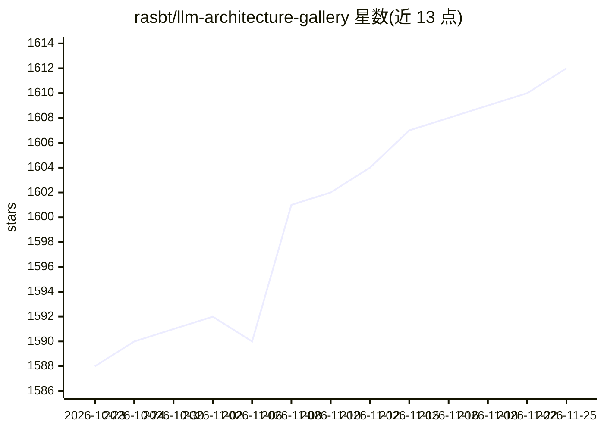

# rasbt/llm-architecture-gallery

⭐ 1,612 · Apache-2.0 · 推送 2026-11-11 · [GitHub](https://github.com/rasbt/llm-architecture-gallery) · [官网](https://sebastianraschka.com/llm-architecture-gallery/) · 个人维护

**LLM 架构图集的元数据公开快照库**

这是 Sebastian Raschka 维护的 LLM Architecture Gallery 的公开数据导出仓库：每季度更新一次图集元数据快照，交互式图集网站本身独立托管在作者个人站点并免费开放。每周元数据导出与架构图片 ZIP 打包仅面向其付费订阅（Ahead of AI）订阅者，订阅用于支持图集的持续维护。仓库定位为轻量级公开数据导出，而非完整网站实现。

## 筛选速览

| 维度 | 判定 | 备注 |
|---|---|---|
| AI 角色 | `ai-knowledge` | 知识聚合/清单类 |
| 许可风险 | `permissive` | Apache-2.0 |
| 部署形态 | `None` |  |
| 模型依赖 | — | README 未给出锁定关系 |
| 硬件要求 | — | 无带数字的原话,不猜 |
| 安装摩擦 | `low` | 无编译、无系统依赖或容器化 |
| 成熟度 | — | 结构信号不足 |

## 能力要点

- 每季度更新的图集元数据公开快照
- 交互式图集网站免费公开并可在线访问
- 每周导出与图片 ZIP 作为订阅者福利提供

## 适用场景

- 在线浏览 LLM 架构图集
- 获取图集元数据的公开快照数据

## 场景标签

`精选清单` · 领域:学习与行业

## 证据(README 行号)

> L3: This repository contains a public snapshot of the LLM Architecture Gallery metadata, updated quarterly.
> L21: This repository is intended as a lightweight public data export of the gallery metadata rather than the full websit

## 星数曲线

2026-10-23 1,588 → 2026-11-25 1,612（+24）

---
*卡片 v1 · prompt 1.4 · 生成 2026-11-23 · 置信度 high · 依据 README sha `30f7ff565e78` · [字段定义](../../DATASET.md)*
