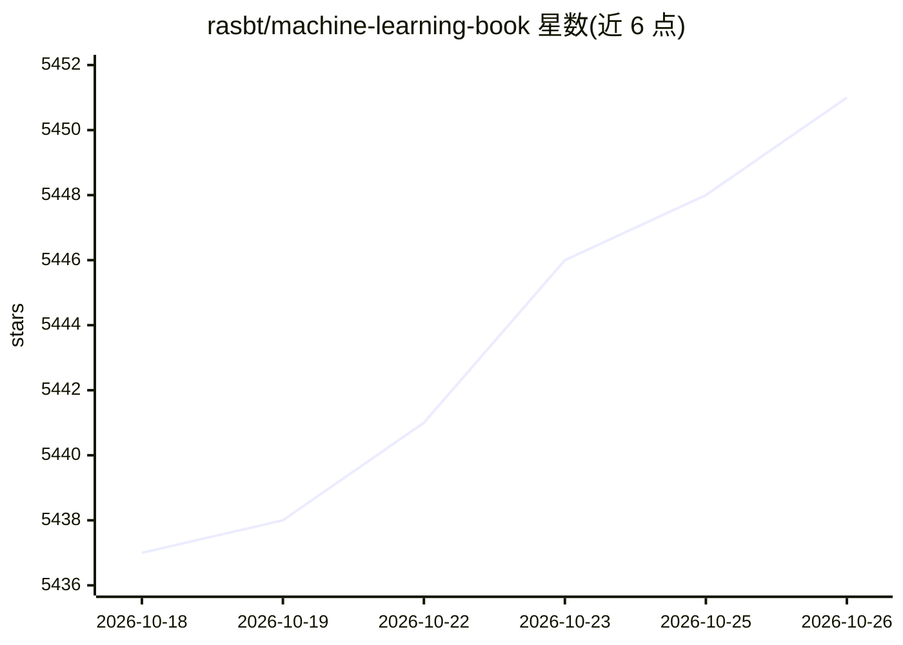

# rasbt/machine-learning-book

⭐ 5,451 · Jupyter Notebook · MIT · 推送 2026-06-15 · [GitHub](https://github.com/rasbt/machine-learning-book) · [官网](https://sebastianraschka.com/books/#machine-learning-with-pytorch-and-scikit-learn) · 个人维护

**《Machine Learning with PyTorch and Scikit-Learn》一书配套代码仓库**

Packt 出版的机器学习教材（770 页，2022）的官方代码仓库，作者为 Sebastian Raschka、Yuxi (Hayden) Liu 与 Vahim Mirjalili。提供 19 章的 Jupyter notebook 代码示例，覆盖 scikit-learn 分类回归聚类、PyTorch 神经网络训练、CNN、RNN、Transformer、GAN、图神经网络与强化学习。安装与运行环境说明位于 ch01/README.md，另有社区编写的 Google Colab 运行指南。README 提示 notebook 脱离书中公式与文字可能不适用。

## 筛选速览

| 维度 | 判定 | 备注 |
|---|---|---|
| AI 角色 | `ai-knowledge` | 知识聚合/清单类 |
| 许可风险 | `permissive` | MIT |
| 部署形态 | `None` |  |
| 模型依赖 | — | README 未给出锁定关系 |
| 硬件要求 | — | 无带数字的原话,不猜 |
| 安装摩擦 | `low` | 无编译、无系统依赖或容器化 |
| 成熟度 | — | 结构信号不足 |

## 能力要点

- 19 章代码 notebook，从 scikitlearn 基础到 Transformer/GAN/GNN/RL
- 第 1 章 README 提供环境安装与配置说明
- 含 Google Colab 运行指南与塞尔维亚语版译本信息

## 适用场景

- 跟随该书学习机器学习与 PyTorch 并运行书中示例
- 在 Google Colab 上运行配套 notebook
- 查阅各章代码目录作为学习路径参考

## 场景标签

`教程课程` · 领域:学习与行业

## 证据(README 行号)

> L1: # *Machine Learning with PyTorch and Scikit-Learn* Book
> L21: **Helpful installation and setup instructions can be found in the README.md file of Chapter 1**.
> L47: Sebastian Raschka, Yuxi (Hayden) Liu, and Vahid Mirjalili. *Machine Learning with PyTorch and Scikit-Learn*. Packt 

## 星数曲线

2026-10-18 5,437 → 2026-10-26 5,451（+14）

---
*卡片 v1 · prompt 1.4 · 生成 2026-10-20 · 置信度 high · 依据 README sha `22164a6a0f1d` · [字段定义](../../DATASET.md)*
