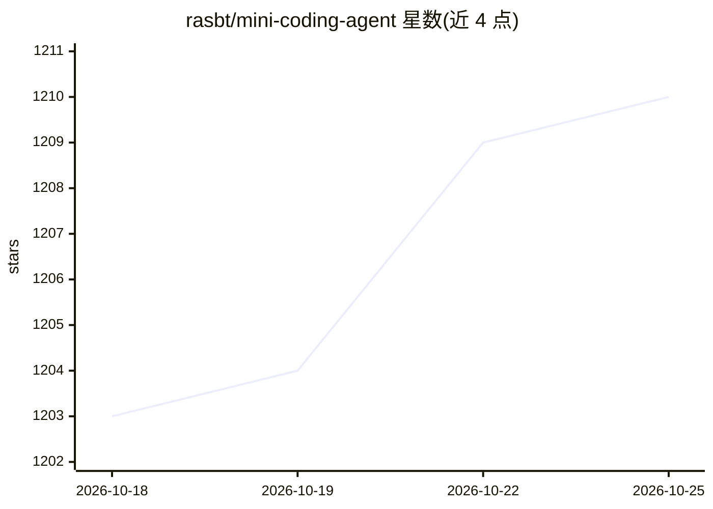

# rasbt/mini-coding-agent

⭐ 1,210 · Python · Apache-2.0 · 推送 2026-04-07 · [GitHub](https://github.com/rasbt/mini-coding-agent) · [官网](https://magazine.sebastianraschka.com/p/components-of-a-coding-agent) · 个人维护

**教学用极简编码代理实现，解释 coding agent 核心组件**

Sebastian Raschka 维护的独立编码代理（单文件 Python 脚本 + mini-coding-agent CLI），围绕六个组件组织：工作区快照、稳定 prompt 前缀与缓存复用、带校验与审批门控的结构化工具、上下文压缩、持久化 transcript 与记忆、有界子代理委派。模型后端基于本地 Ollama（默认 qwen3.5:4b，走 /api/generate），无标准库之外的 Python 依赖，可用 uv 或直接 python 运行。作者声明该项目面向可读性而非健壮性。

## 筛选速览

| 维度 | 判定 | 备注 |
|---|---|---|
| AI 角色 | `ai-ecosystem` | LLM/agent 周边工具 |
| 许可风险 | `permissive` | Apache-2.0 |
| 部署形态 | `None` |  |
| 模型依赖 | local-ok | 支持本地模型 |
| 硬件要求 | — | 无带数字的原话,不猜 |
| 安装摩擦 | `low` | 无编译、无系统依赖或容器化 |
| 成熟度 | — | 结构信号不足 |

## 能力要点

- 单文件实现，无 Python 标准库以外的运行时依赖
- 六组件架构：工作区快照/稳定 prompt/结构化工具与审批/上下文压缩/会话持久化/有界委派
- Ollama 本地后端，默认 qwen3.5:4b
- 会话可保存与恢复（--resume），REPL 内置斜杠命令

## 适用场景

- 学习编码代理的内部工作原理
- 作为自己代理实现的起点或参考骨架
- 在本地 Ollama 模型上实验工具调用与审批机制

## 场景标签

`编码 Agent` `教程课程` · 领域:编码与开发

## 证据(README 行号)

> L4: This folder contains a small standalone coding agent:
> L18: The model backend is currently based on Ollama.
> L33: This coding harness is organized around six practical building blocks:

## 星数曲线

2026-10-18 1,203 → 2026-10-25 1,210（+7）

---
*卡片 v1 · prompt 1.4 · 生成 2026-10-21 · 置信度 high · 依据 README sha `7a408bc2430d` · [字段定义](../../DATASET.md)*
