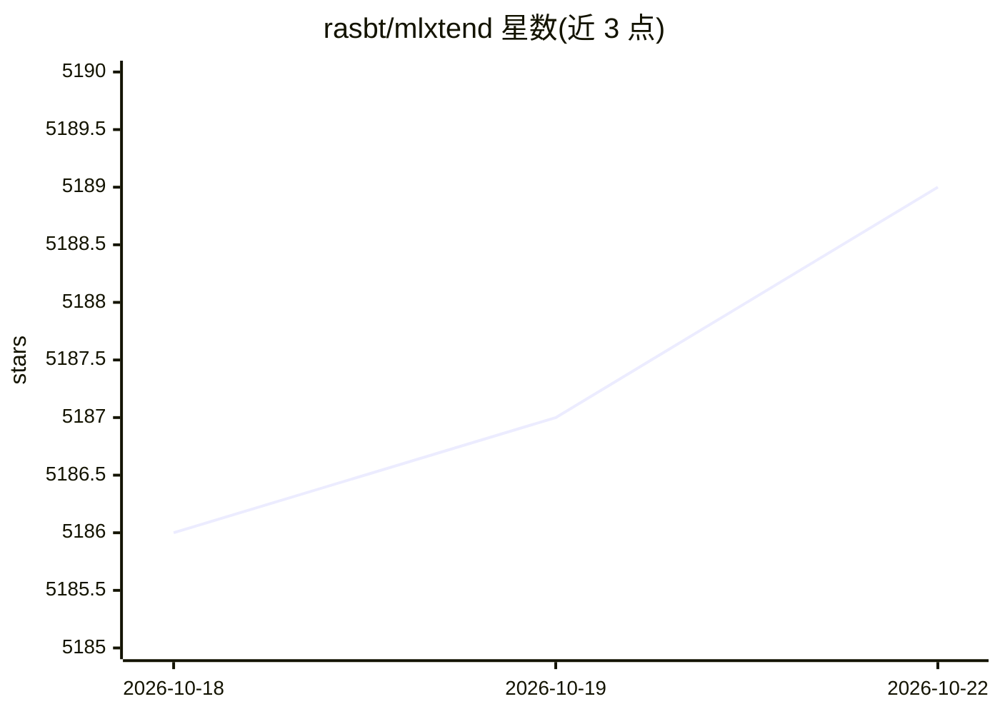

# rasbt/mlxtend

⭐ 5,189 · Python · NOASSERTION · 推送 2026-10-09 · [GitHub](https://github.com/rasbt/mlxtend) · [官网](https://rasbt.github.io/mlxtend/) · 个人维护

**Python 数据科学与机器学习任务的扩展工具库**

面向日常数据科学工作流的 Python 工具库，提供集成学习（stacking、投票分类器）、特征选择与特征提取、决策区域与混淆矩阵等可视化工具，以及 Apriori 关联规则挖掘等频繁模式挖掘算法。由 Sebastian Raschka 自 2014 年起维护，通过 PyPI 与 uv 分发，附有 JOSS 论文 DOI 供学术引用，采用 BSD-3 许可证且明确声明可商用。

## 筛选速览

| 维度 | 判定 | 备注 |
|---|---|---|
| AI 角色 | `ai-ecosystem` | LLM/agent 周边工具 |
| 许可风险 | `permissive` | NOASSERTION |
| 部署形态 | `library` | 以包/库形式分发 |
| 模型依赖 | — | README 未给出锁定关系 |
| 硬件要求 | — | 无带数字的原话,不猜 |
| 安装摩擦 | `low` | 无编译、无系统依赖或容器化 |
| 成熟度 | — | 结构信号不足 |

## 能力要点

- stacking 与投票分类器等集成方法
- 特征选择与特征提取技术
- 决策区域、混淆矩阵等可视化工具
- Apriori 算法的关联规则挖掘

## 适用场景

- 为 scikit-learn 工作流补充 stacking 等集成方法
- 对分类器做决策区域等可视化分析
- 从事务数据中挖掘频繁模式与关联规则

## 场景标签

 · 领域:机器学习/数据科学

## 证据(README 行号)

> L11: **Mlxtend (machine learning extensions) is a Python library of useful tools for the day-to-day data science tasks.*
> L13: - Ensemble methods such as stacking and voting classifiers

## 星数曲线

2026-10-18 5,186 → 2026-10-22 5,189（+3）

---
*卡片 v1 · prompt 1.4 · 生成 2026-10-20 · 置信度 high · 依据 README sha `2c51919c1eed` · [字段定义](../../DATASET.md)*
