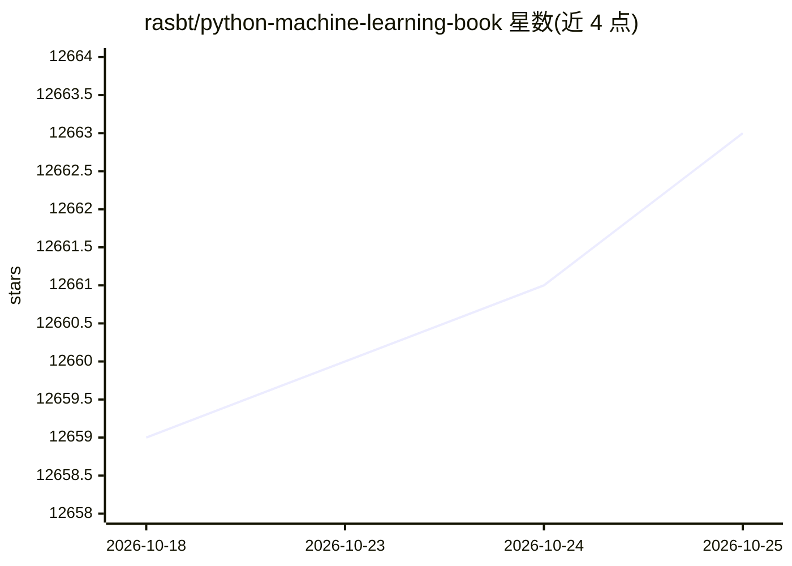

# rasbt/python-machine-learning-book

⭐ 12,664 · Jupyter Notebook · MIT · 推送 2026-07-18 · [GitHub](https://github.com/rasbt/python-machine-learning-book) · 个人维护

**《Python Machine Learning》(第1版)一书的配套代码与资料仓库**

Sebastian Raschka 所著《Python Machine Learning》第1版（Packt，2015年9月出版，454页）的代码示例仓库：13 章内容覆盖分类、数据预处理、降维、模型评估与超参优化、集成学习、情感分析、回归、聚类、神经网络与 Theano 并行训练，每章提供 ipynb/nbviewer 笔记本，主要使用 NumPy、scikit-learn 与 Theano。另附公式参考 PDF/TEX、教学幻灯片链接、数学与 NumPy 免费补充章节、BibTeX 引用格式、勘误、未收录的附加笔记本与读者 FAQ。README 明确提示代码笔记本脱离书中公式与文字可能不完整。

## 筛选速览

| 维度 | 判定 | 备注 |
|---|---|---|
| AI 角色 | `ai-knowledge` | 知识聚合/清单类 |
| 许可风险 | `permissive` | MIT |
| 部署形态 | `None` |  |
| 模型依赖 | — | README 未给出锁定关系 |
| 硬件要求 | — | 无带数字的原话,不猜 |
| 安装摩擦 | `low` | 无编译、无系统依赖或容器化 |
| 成熟度 | — | 结构信号不足 |

## 能力要点

- 13 章代码笔记本，主要使用 NumPy/scikit-learn/Theano
- 免费补充章节：代数、微积分、NumPy 入门（PDF/EPUB）
- 附加笔记本：从零实现逻辑回归、嵌套交叉验证、Flask 模板等
- 含公式参考、教学幻灯片链接与 BibTeX 引用格式

## 适用场景

- 随书学习机器学习理论与实践
- 查找各章代码示例与附加实现
- 为教学寻找幻灯片与补充资料

## 场景标签

`教程课程` · 领域:学习与行业

## 证据(README 行号)

> L1: # Python Machine Learning book code repository
> L30: ## Table of Contents and Code Notebooks
> L33: **Please note that these are just the code examples accompanying the book, which I uploaded for your convenience; b

## 星数曲线

2026-10-18 12,659 → 2026-10-25 12,663（+4）

---
*卡片 v1 · prompt 1.4 · 生成 2026-10-20 · 置信度 high · 依据 README sha `8c8aae0ea96f` · [字段定义](../../DATASET.md)*
