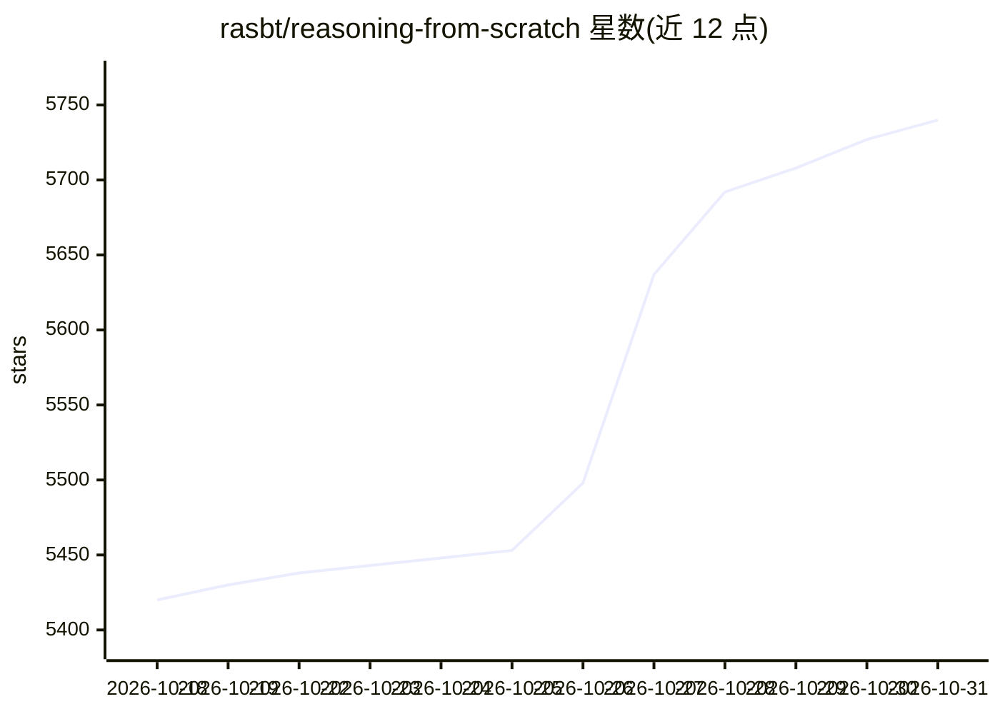

# rasbt/reasoning-from-scratch

⭐ 5,740 · Jupyter Notebook · Apache-2.0 · 推送 2026-10-27 · [GitHub](https://github.com/rasbt/reasoning-from-scratch) · [官网](https://mng.bz/lZ5B) · 个人维护

**从零构建推理 LLM 的图书配套代码（PyTorch）**

《Build A Reasoning Model (From Scratch)》(Manning, 2025, Sebastian Raschka) 的官方代码仓库：从预训练开源基座模型 Qwen3 出发，逐步用代码实现推理能力，覆盖推理时扩展（CoT 提示、自一致性、Best-of-N、自我精炼）、GRPO 强化学习训练（含 DeepSeek-V3.2-、Olmo3-、GDPO 风格变体）与推理蒸馏（经 Ollama/OpenRouter 生成教师输出）。代码面向消费级硬件，第 2-4 章可在 CPU/GPU 运行，第 5-6 章建议使用 GPU。各章附练习与答案 notebook；因对应纸质书内容，不接受扩展主章节代码的贡献。

## 筛选速览

| 维度 | 判定 | 备注 |
|---|---|---|
| AI 角色 | `ai-knowledge` | 知识聚合/清单类 |
| 许可风险 | `permissive` | Apache-2.0 |
| 部署形态 | `None` |  |
| 模型依赖 | local-ok | 支持本地模型 |
| 硬件要求 | — | 无带数字的原话,不猜 |
| 安装摩擦 | `low` | 无编译、无系统依赖或容器化 |
| 成熟度 | — | 结构信号不足 |

## 能力要点

- 在 Qwen3 基座上从零实现推理方法（推理时扩展/RL/蒸馏）
- GRPO 脚本含批处理模式及多种风格变体
- MATH-500 评测与验证脚本、蒸馏数据生成与 checkpoint 下载
- 章节练习及答案 notebook

## 适用场景

- 跟随图书逐步学习推理 LLM 的实现原理
- 在自己的小模型上复现 DeepSeek R1 类推理训练方法
- 学习推理时扩展与 GRPO 强化学习实践

## 场景标签

`强化学习` `教程课程` · 领域:学习与行业

## 证据(README 行号)

> L3: This repository contains the code for developing an LLM reasoning model and is the official code repository for the 
> L33: In this book, we work with a pre-trained open-source base LLM (Qwen3) on top of which we code apply reasoning metho

## 星数曲线

2026-10-18 5,420 → 2026-10-31 5,740（+320）

---
*卡片 v1 · prompt 1.4 · 生成 2026-10-20 · 置信度 high · 依据 README sha `deeef3f2620b` · [字段定义](../../DATASET.md)*
