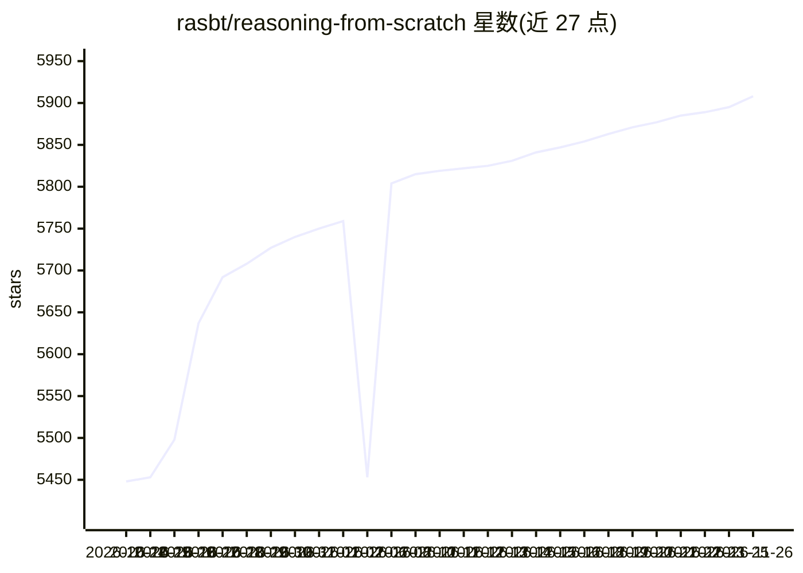

# rasbt/reasoning-from-scratch

⭐ 5,908 · Jupyter Notebook · Apache-2.0 · 推送 2026-11-25 · [GitHub](https://github.com/rasbt/reasoning-from-scratch) · [官网](https://mng.bz/lZ5B) · 个人维护

**书籍配套代码：从零用 PyTorch 逐步实现推理 LLM**

这是《Build a Reasoning Model (From Scratch)》一书的官方代码仓库，面向学习推理大模型原理的读者。以预训练 Qwen3 基座模型为起点，分章节用代码实现推理时扩展、强化学习（GRPO）、蒸馏等推理能力，附每章练习解答 notebook、MATH-500 评测脚本、训练检查点下载与聊天界面等附加材料。主章节代码设计为可在消费级硬件运行，第 5-6 章复现结果建议用 GPU。接受反馈但不接受扩展主章节代码的贡献，以保持与纸质书一致。

## 筛选速览

| 维度 | 判定 | 备注 |
|---|---|---|
| AI 角色 | `ai-knowledge` | 知识聚合/清单类 |
| 许可风险 | `permissive` | Apache-2.0 |
| 部署形态 | `None` |  |
| 模型依赖 | — | README 未给出锁定关系 |
| 硬件要求 | — | 无带数字的原话,不猜 |
| 安装摩擦 | `low` | 无编译、无系统依赖或容器化 |
| 成熟度 | — | 结构信号不足 |

## 能力要点

- 8 章 + 附录结构，覆盖 CoT、自洽性、自我精修、GRPO、蒸馏等推理方法
- 第 7 章含 DeepSeek-V3.2-/Olmo3-/GDPO 风格的进阶 GRPO 脚本
- 提供第 6-8 章训练检查点的下载与 transformers 加载方法
- 主章节代码可在消费级 CPU/GPU 上运行，自动检测 GPU

## 适用场景

- 想从代码层面理解 DeepSeek R1 类推理模型如何被训练出来
- 按章节练习实现推理时扩展与强化学习训练
- 在本地消费级硬件上跑通小型推理模型的训练流程

## 场景标签

`模型评测` `模型训练` `强化学习` `教程课程` · 领域:评测与运维

## 证据(README 行号)

> L3: This repository contains the code for developing an LLM reasoning model and is the official code repository for the 
> L9: Reasoning is one of the most exciting and important recent advances in improving LLMs, but it’s also one of the easi
> L31: Please note that *Build A Reasoning Model (From Scratch)* is a standalone book focused on methods to improve LLM re

## 星数曲线

2026-10-24 5,448 → 2026-11-26 5,908（+460）

---
*卡片 v1 · prompt 1.4 · 生成 2026-11-26 · 置信度 high · 依据 README sha `8f71c057b88e` · [字段定义](../../DATASET.md)*
