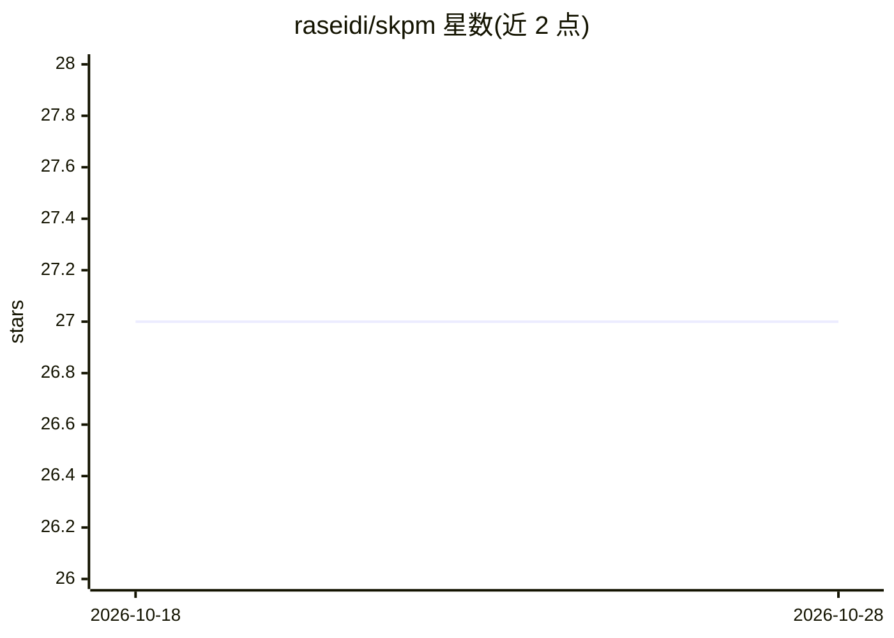

# raseidi/skpm

⭐ 27 · Python · MIT · 推送 2026-08-19 · [GitHub](https://github.com/raseidi/skpm) · [官网](https://skpm.readthedocs.io/en/latest/) · 个人维护

**基于 scikit-learn 的过程挖掘库：把事件日志变成无泄漏的监督学习问题**

构建在 scikit-learn 与 pandas 之上的 Python 过程挖掘模块：将事件日志转化为监督学习问题，提供时间感知切分、预测目标构造、特征抽取与前缀编码，全部以普通 sklearn transformer 形式实现，可与 Pipeline、ColumnTransformer、GridSearchCV 组合使用。面向做预测性过程监控（如剩余时间预测、下一活动预测）的开发者与科研用户；输入事件日志无需专门 loader 类。曾发表于 CoopIS 2023 demonstration track。

## 筛选速览

| 维度 | 判定 | 备注 |
|---|---|---|
| AI 角色 | `ai-native` | 本体是模型或模型工具 |
| 许可风险 | `permissive` | MIT |
| 部署形态 | `library` | 以包/库形式分发 |
| 模型依赖 | — | README 未给出锁定关系 |
| 硬件要求 | — | 无带数字的原话,不猜 |
| 安装摩擦 | `low` | 无编译、无系统依赖或容器化 |
| 成熟度 | — | 结构信号不足 |

## 能力要点

- 时间感知切分避免未来信息泄漏到过去
- 特征抽取与前缀编码实现为 sklearn transformer
- 与 Pipeline / ColumnTransformer / GridSearchCV 直接组合
- 直接读取 CSV 事件日志，无需专门 loader 类

## 适用场景

- 预测每个进行中案例还需多长时间（剩余时间预测）
- 下一活动预测等预测性过程监控任务
- 在 BPI Challenge 等公开基准日志上构建流程预测流水线

## 场景标签

 · 领域:数据科学/过程挖掘

## 证据(README 行号)

> L9: **SkPM** is a Python module for process mining built on top of scikit-learn and
> L14: shortcut leaks the future into the past. SkPM turns an event log into a
> L15: supervised learning problem without leaking it — time-aware splits, prediction

## 星数曲线

2026-10-18 27 → 2026-10-28 27（+0）

---
*卡片 v1 · prompt 1.4 · 生成 2026-10-26 · 置信度 mid · 依据 README sha `71e80f9027c3` · [字段定义](../../DATASET.md)*
