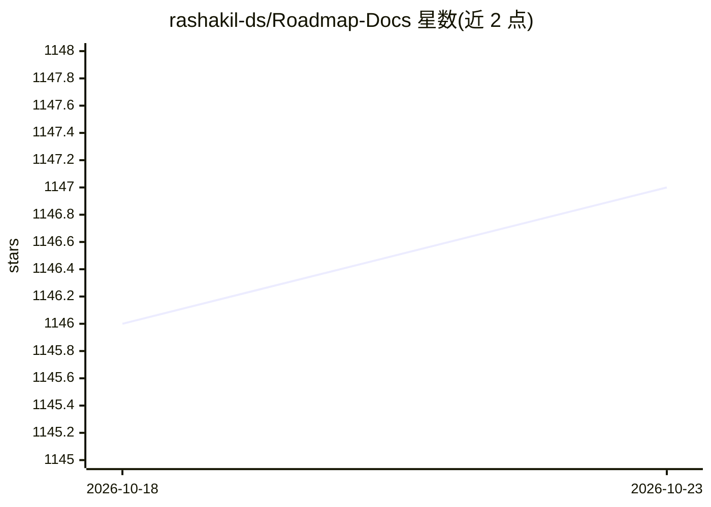

# rashakil-ds/Roadmap-Docs

⭐ 1,147 · 推送 2026-10-21 · [GitHub](https://github.com/rashakil-ds/Roadmap-Docs) · [官网](https://www.youtube.com/@StudyMart) · 个人维护

**数据科学与 AI 职业学习路线图文档合集（11 类岗位）**

面向学生、从业者与 AI 学习者的职业路线图文档仓库，覆盖 Data Analyst、Data Engineer、Data Scientist、AI Engineer、AI Agent Developer、Machine Learning Engineer、NLP Engineer 等 11 类岗位方向。内容依据 LinkedIn 与 Indeed 上数据科学与 AI 领域的热门职位发布持续更新，每个岗位对应一个文件夹，内含 README 指南，列出该岗位的技能、工具、学习材料、项目建议与职业提示。仓库以 Markdown 文档形式提供，通过浏览文件夹阅读使用，接受 issue 反馈与 pull request 贡献。

## 筛选速览

| 维度 | 判定 | 备注 |
|---|---|---|
| AI 角色 | `ai-knowledge` | 知识聚合/清单类 |
| 许可风险 | `none` | — |
| 部署形态 | `None` |  |
| 模型依赖 | — | README 未给出锁定关系 |
| 硬件要求 | — | 无带数字的原话,不猜 |
| 安装摩擦 | `low` | 无编译、无系统依赖或容器化 |
| 成熟度 | — | 结构信号不足 |

## 能力要点

- 覆盖 11 类数据/AI/SDE 岗位的路线图
- 依据 LinkedIn 与 Indeed 热门职位发布持续更新
- 每个岗位文件夹内含 README 指南、学习材料与职业建议

## 适用场景

- 想进入数据科学或 AI 岗位的学习者查看学习路线与时间线
- 在职者对照岗位路线图查漏补缺所需技能
- 了解不同 AI 细分岗位（NLP/CV/生成式 AI 等）的技能要求

## 场景标签

`教程课程` · 领域:学习与行业

## 证据(README 行号)

> L3: Best Data Science, Data Analytics, AI, and SDE roadmaps. This repository is continually updated based on the top `jo
> L5: To succeed in any career, it's **very important** to understand the **roadmap, required skills, and timeline** for t
> L17: This repository contains roadmaps for the following roles:

## 星数曲线

2026-10-18 1,146 → 2026-10-23 1,147（+1）

---
*卡片 v1 · prompt 1.4 · 生成 2026-10-21 · 置信度 high · 依据 README sha `4c3803877686` · [字段定义](../../DATASET.md)*
