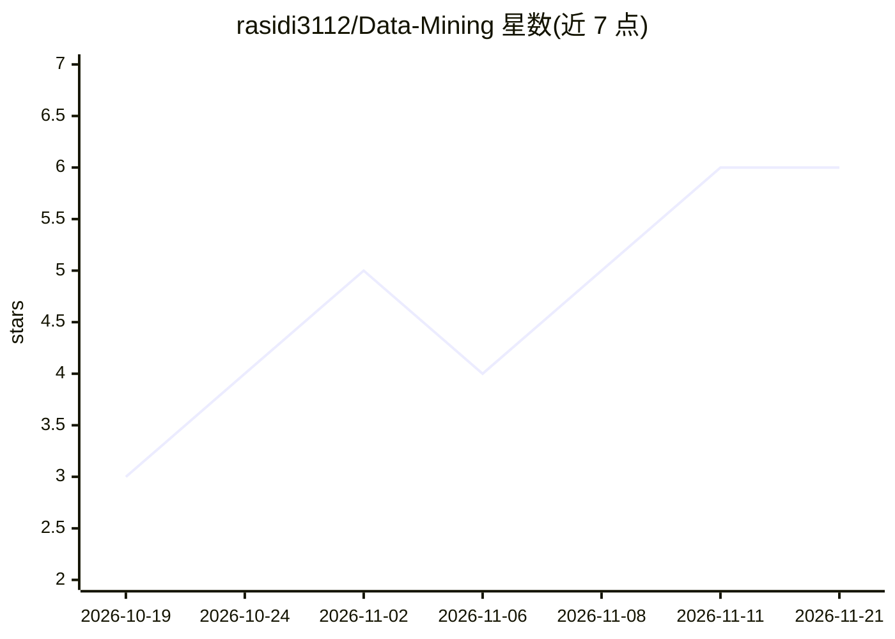

# rasidi3112/Data-Mining

⭐ 6 · Jupyter Notebook · 推送 2026-10-31 · [GitHub](https://github.com/rasidi3112/Data-Mining) · 个人维护

**面向学习者的数据挖掘与机器学习分级教程笔记本**

以 Jupyter Notebook 组织的逐步式数据挖掘学习材料：6 个分级模块覆盖 EDA 与统计描述、基础分类（KNN/决策树/逻辑回归）、超参数调优与集成、端到端表格项目，以及关联规则、异常检测、概率校准、代价敏感决策、漂移监控等进阶主题。Level 5 数据集为模拟生成，算法结果可对照已知模式验证；配套 dmtoolkit Python 包提供可复用函数，并用 pytest 与 GitHub Actions CI 验证。

## 筛选速览

| 维度 | 判定 | 备注 |
|---|---|---|
| AI 角色 | `ai-knowledge` | 知识聚合/清单类 |
| 许可风险 | `none` | — |
| 部署形态 | `library` | 以包/库形式分发 |
| 模型依赖 | — | README 未给出锁定关系 |
| 硬件要求 | — | 无带数字的原话,不猜 |
| 安装摩擦 | `low` | 无编译、无系统依赖或容器化 |
| 成熟度 | — | 结构信号不足 |

## 能力要点

- 6 个分级模块从 EDA 到端到端生产级 pipeline
- Level 5 数据集为模拟生成，结果可对照已知真值验证
- 配套 dmtoolkit 包：Apriori、PSI 漂移检测、实验跟踪、模型卡
- pytest 单元测试与 GitHub Actions CI 自动执行 notebook

## 适用场景

- 系统学习数据挖掘从 EDA 到部署的完整流程
- 复用 dmtoolkit 中的阈值优化与漂移监控函数
- 借鉴 pipeline、ColumnTransformer 等防数据泄漏的工程实践

## 场景标签

`教程课程` · 领域:学习与行业

## 证据(README 行号)

> L3: Repositori ini berisi materi pembelajaran data mining praktis berbasis Python dan scikit-learn. Materi disusun secar
> L7: - `00_indeks_belajar_data_mining.ipynb`: Peta jalan belajar dan pemeriksaan dependensi.

## 星数曲线

2026-10-19 3 → 2026-11-21 6（+3）

---
*卡片 v1 · prompt 1.4 · 生成 2026-11-20 · 置信度 high · 依据 README sha `75c230d97925` · [字段定义](../../DATASET.md)*
