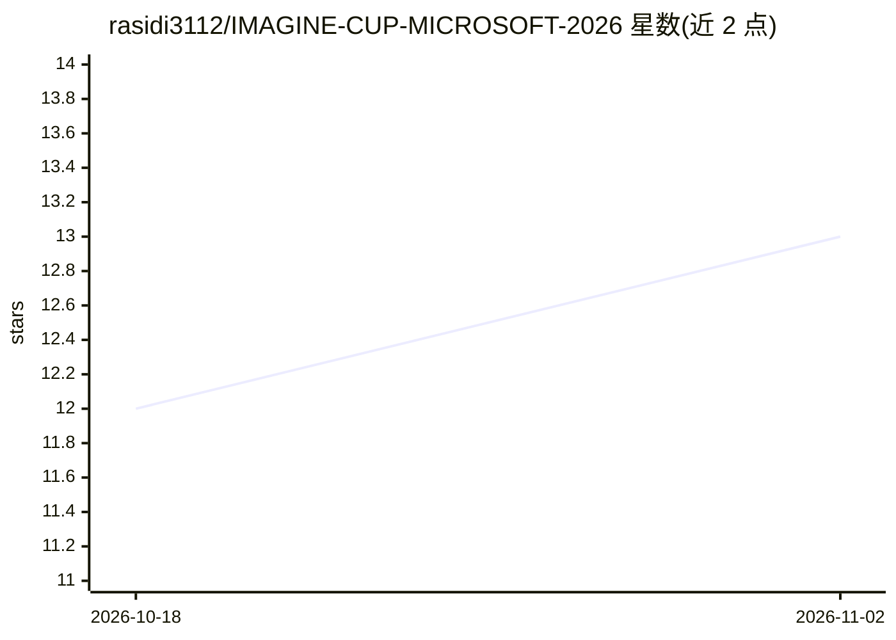

# rasidi3112/IMAGINE-CUP-MICROSOFT-2026

⭐ 13 · Dart · MIT · 推送 2026-01-07 · [GitHub](https://github.com/rasidi3112/IMAGINE-CUP-MICROSOFT-2026) · 组织维护

**面向印尼 NTB 农户的植物病害 AI 检测移动应用**

为印度尼西亚西努沙登加拉省（NTB）农户设计的 Flutter 移动应用：用相机扫描叶片，经 Azure Custom Vision 分类病害，并以 Azure OpenAI（GPT-4）提供农艺咨询对话。附带病害爆发热力图、施药/施肥日历、天气面板、80+ 病害百科、10 种作物种植指南、农药查找与离线模式等功能，支持印尼语、英语及三种当地语言共 5 种语言。后端为 FastAPI + OpenCV，需配置 Azure 服务与 .env 密钥。为 Microsoft Imagine Cup 2026 参赛项目。

## 筛选速览

| 维度 | 判定 | 备注 |
|---|---|---|
| AI 角色 | `ai-native` | 本体是模型或模型工具 |
| 许可风险 | `permissive` | MIT |
| 部署形态 | `None` |  |
| 模型依赖 | locked-api |  |
| 硬件要求 | — | 无带数字的原话,不猜 |
| 安装摩擦 | `low` | 无编译、无系统依赖或容器化 |
| 成熟度 | — | 结构信号不足 |

## 能力要点

- 相机扫描叶片经 Azure Custom Vision 做病害分类
- Azure OpenAI (GPT-4) 提供农艺咨询对话
- 病害爆发热力图、施药日历、天气推荐与 80+ 病害百科
- 5 种语言支持（含 3 种 NTB 当地语言）与离线核心功能

## 适用场景

- 扫描作物叶片识别病害并获取治疗建议
- 查看 NTB 地区病害爆发分布与安排施药施肥
- 无网络环境下使用核心检测与查询功能

## 场景标签

`目标检测` `聊天机器人` · 领域:对话与助手

## 证据(README 行号)

> L20: **AgriVision NTB** is an AI-powered mobile application designed to help farmers in **Nusa Tenggara Barat (NTB), Ind
> L28: |**Disease Detection**|Scan plant leaves using camera to detect diseases with AI|
> L84: |**Azure Custom Vision**|Plant disease classification model|

## 星数曲线

2026-10-18 12 → 2026-11-02 13（+1）

---
*卡片 v1 · prompt 1.4 · 生成 2026-11-01 · 置信度 high · 依据 README sha `4b548821a17e` · [字段定义](../../DATASET.md)*
