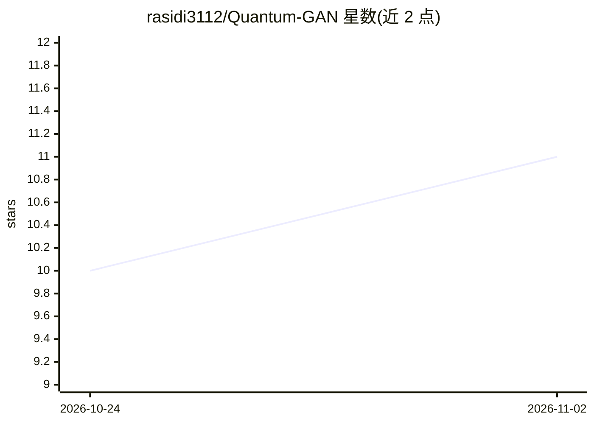

# rasidi3112/Quantum-GAN

⭐ 11 · Python · MIT · 推送 2026-10-13 · [GitHub](https://github.com/rasidi3112/Quantum-GAN) · 个人维护

**量子生成对抗网络实验项目：量子生成器生成 2D 合成数据**

基于 PennyLane 与 PyTorch 实现的量子生成对抗网络：生成器为变分量子电路（VQC，经 PennyLane QNode 构建），判别器为 PyTorch 多层感知机；用于生成近似真实数据的 2D 噪声圆形合成数据，并提供真实/生成数据对比与损失曲线可视化。可选接入 Qiskit Aer 进行量子期望推断与噪声模拟。面向量子机器学习方向的实验探索，推荐 Python 3.12 虚拟环境运行，从源码安装依赖。

## 筛选速览

| 维度 | 判定 | 备注 |
|---|---|---|
| AI 角色 | `ai-native` | 本体是模型或模型工具 |
| 许可风险 | `permissive` | MIT |
| 部署形态 | `None` |  |
| 模型依赖 | — | README 未给出锁定关系 |
| 硬件要求 | — | 无带数字的原话,不猜 |
| 安装摩擦 | `low` | 无编译、无系统依赖或容器化 |
| 成熟度 | — | 结构信号不足 |

## 能力要点

- 变分量子电路生成器（PennyLane QNode）+ PyTorch MLP 判别器
- 生成 2D 噪声圆形合成数据并提供可视化与损失分析
- 可选 Qiskit Aer 量子期望推断与噪声模拟

## 适用场景

- 学习量子计算与经典机器学习的结合方式
- 实验量子生成对抗网络的训练与可视化
- 探索 QGAN 在物理模拟与合成数据集上的应用

## 场景标签

 · 领域:量子机器学习

## 证据(README 行号)

> L11: - **Quantum Generator**: using **Variational Quantum Circuit (VQC)** via **PennyLane**
> L12: - **Classical Discriminator**: Multi-Layer Perceptron (MLP) implemented in **PyTorch**

## 星数曲线

2026-10-24 10 → 2026-11-02 11（+1）

---
*卡片 v1 · prompt 1.4 · 生成 2026-11-02 · 置信度 high · 依据 README sha `ec2136eb71f6` · [字段定义](../../DATASET.md)*
