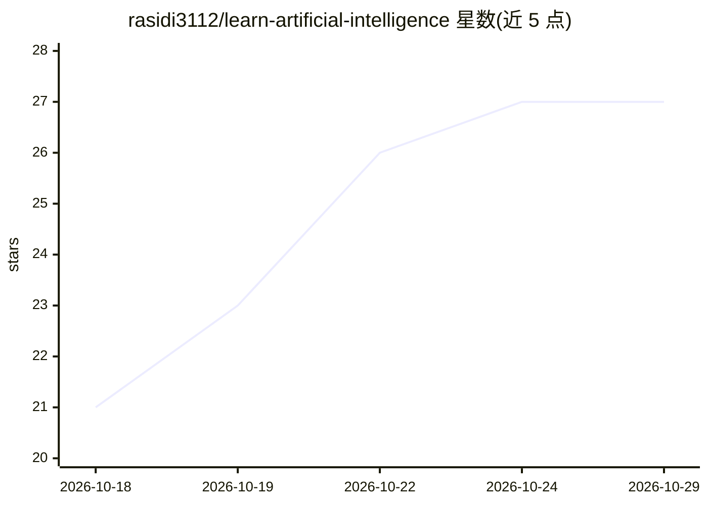

# rasidi3112/learn-artificial-intelligence

⭐ 27 · JavaScript · MIT · 推送 2026-10-22 · [GitHub](https://github.com/rasidi3112/learn-artificial-intelligence) · [官网](https://rasidi3112.github.io/learn-artificial-intelligence/) · 个人维护 · 中文 README

**面向初学者与教师的免费开源 AI 静态课程网站（17 模块）**

一个无构建步骤、纯 HTML/CSS/JavaScript 的静态网站课程：17 个模块从神经网络基础覆盖到 LLM、AI Agent、RAG 与边缘 AI，共约 380 分钟阅读量，含浏览器内神经网络训练 playground、37 题随机化测验、15 种语言界面、进度追踪、笔记与自签发 PDF 证书。所有数据存于 localStorage，可 JSON 导入导出，首次访问后可离线运行。面向学生、转行者和教师，可直接部署到 GitHub Pages 或校内网。

## 筛选速览

| 维度 | 判定 | 备注 |
|---|---|---|
| AI 角色 | `ai-knowledge` | 知识聚合/清单类 |
| 许可风险 | `permissive` | MIT |
| 部署形态 | `None` |  |
| 模型依赖 | — | README 未给出锁定关系 |
| 硬件要求 | — | 无带数字的原话,不猜 |
| 安装摩擦 | `low` | 无编译、无系统依赖或容器化 |
| 成熟度 | — | 结构信号不足 |

## 能力要点

- 17 个模块，380 分钟阅读量，覆盖从神经元到 RAG 与边缘 AI
- 浏览器内神经网络 playground：可拖动权重、加层、观察决策边界
- 37 题随机化测验 + 自签发 PDF 证书 + JSON 进度导出
- 15 种语言（含 RTL 阿拉伯语），localStorage 存储与离线缓存

## 适用场景

- 自学 AI 基础，从零开始系统了解神经网络到 LLM
- 课堂教学：学生免注册打开链接即学，导出测验结果作作业凭证
- 校内网或离线环境下运行完整课程

## 场景标签

`教程课程` · 领域:学习与行业

## 证据(README 行号)

> L3: **A free, open course on artificial intelligence: seventeen modules, a 37-question quiz and fifteen languages, in on
> L31: |**17 modules**|380 minutes of reading, from "What is AI?" to AI agents, RAG, robotics and edge AI|

## 星数曲线

2026-10-18 21 → 2026-10-29 27（+6）

---
*卡片 v1 · prompt 1.4 · 生成 2026-10-26 · 置信度 high · 依据 README sha `790c70bacdff` · [字段定义](../../DATASET.md)*
