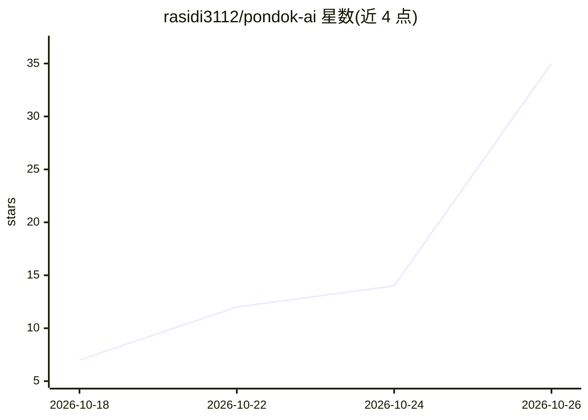

# rasidi3112/pondok-ai

⭐ 35 · TypeScript · MIT · 推送 2026-10-23 · [GitHub](https://github.com/rasidi3112/pondok-ai) · [官网](https://www.npmjs.com/package/pondok-ai) · 个人维护

**一条命令在本地搭建私有 AI 全栈（Ollama+Open WebUI+RAG+API）**

npm 分发的 CLI 工具：检测硬件（OS/架构/RAM/磁盘/GPU），生成并启动基于 Docker Compose 的本地 AI 栈，按 minimal/standard/full 三档预设组合 Ollama、Open WebUI、Qdrant、PostgreSQL、API 网关与 n8n。提供模型管理（按 RAM/VRAM 推荐、带预检的安装）、诊断、备份与 `share` 命令——同一 Wi-Fi 下他人扫码注册、管理员审批后即可在各自设备使用。API 网关提供 OpenAI 兼容端点。限制：Windows 未测试，Apple Silicon 容器内无法用 GPU（需 --native-ollama 走 Metal），镜像体积达数 GB。

## 筛选速览

| 维度 | 判定 | 备注 |
|---|---|---|
| AI 角色 | `ai-ecosystem` | LLM/agent 周边工具 |
| 许可风险 | `permissive` | MIT |
| 部署形态 | `self-host` | docker 或自建部署 |
| 模型依赖 | local-ok | 支持本地模型 |
| 硬件要求 | — | 无带数字的原话,不猜 |
| 安装摩擦 | `low` | 无编译、无系统依赖或容器化 |
| 成熟度 | — | 结构信号不足 |

## 能力要点

- 硬件检测后生成适配的 Docker Compose 栈（minimal/standard/full 预设）
- `share` 以二维码向局域网共享 Open WebUI，含账号审批与安全默认
- OpenAI 兼容 API 网关（限流 120 req/min，密钥认证）
- 模型推荐与安装前 RAM/磁盘预检，备份带 SHA-256 校验

## 适用场景

- 教室或办公室用一台机器给多人提供私有聊天服务
- 本地搭建带 RAG 的私有 LLM 栈替代外部 API
- 按自己硬件选型并安装合适的本地模型

## 场景标签

`RAG` `聊天机器人` · 领域:对话与助手

## 证据(README 行号)

> L28: `pondok-ai` is a CLI that boots a complete, private AI environment on your own machine. It generates a Docker Compo
> L5: Local LLMs, a chat UI, vector search, and an OpenAI-compatible API, wired together with Docker Compose.

## 星数曲线

2026-10-18 7 → 2026-10-26 35（+28）

---
*卡片 v1 · prompt 1.4 · 生成 2026-10-26 · 置信度 mid · 依据 README sha `617d3e682b25` · [字段定义](../../DATASET.md)*
