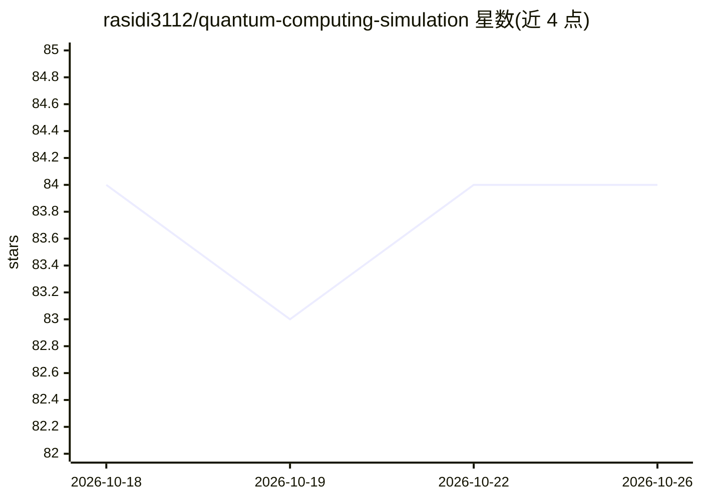

# rasidi3112/quantum-computing-simulation

⭐ 84 · Python · MIT · 推送 2026-02-15 · [GitHub](https://github.com/rasidi3112/quantum-computing-simulation) · [官网](https://quantum-computing-simulation.streamlit.app/) · 个人维护 · 中文 README

**浏览器中交互学习量子计算的可视化模拟器**

基于 Streamlit、NumPy 与 Matplotlib 的教学型量子计算模拟网页应用：支持初始化最多 3 个量子比特，实时查看态矢量幅值与概率，交互式施加 Hadamard、Pauli、S、T、CNOT 等门，进行可配置次数（100–10,000）的测量并展示概率直方图，可查看门的酉矩阵及电路操作历史。界面提供 15 种语言完整翻译。声明受 IBM Quantum Lab 与 Qiskit 可视化启发但与 IBM 无关。通过 git clone 源码加 pip 依赖安装后以 streamlit run 运行。

## 筛选速览

| 维度 | 判定 | 备注 |
|---|---|---|
| AI 角色 | `ai-enhanced` | 去掉 AI 部分产品仍成立 |
| 许可风险 | `permissive` | MIT |
| 部署形态 | `library` | 以包/库形式分发 |
| 模型依赖 | — | README 未给出锁定关系 |
| 硬件要求 | — | 无带数字的原话,不猜 |
| 安装摩擦 | `low` | 无编译、无系统依赖或容器化 |
| 成熟度 | — | 结构信号不足 |

## 能力要点

- 最多 3 量子比特实时态矢量与概率可视化
- 支持 Hadamard/Pauli/S/T/CNOT 门及酉矩阵查看
- 可配置 shots（100–10,000）的测量模拟与直方图
- 15 种语言的完整界面翻译

## 适用场景

- 初学者在浏览器中直观理解叠加与纠缠
- 教学演示量子门对态演化的影响
- 观察测量概率分布与电路操作历史

## 场景标签

 · 领域:量子计算教育

## 证据(README 行号)

> L10:  Mini Quantum Lab is an educational web simulator designed to help learners explore the fundamentals of
> L12:  It enables users to visualize quantum state evolution, apply quantum gates dynamically, simulate qubit measurement

## 星数曲线

2026-10-18 84 → 2026-10-26 84（+0）

---
*卡片 v1 · prompt 1.4 · 生成 2026-10-24 · 置信度 mid · 依据 README sha `f05b5fa6d853` · [字段定义](../../DATASET.md)*
