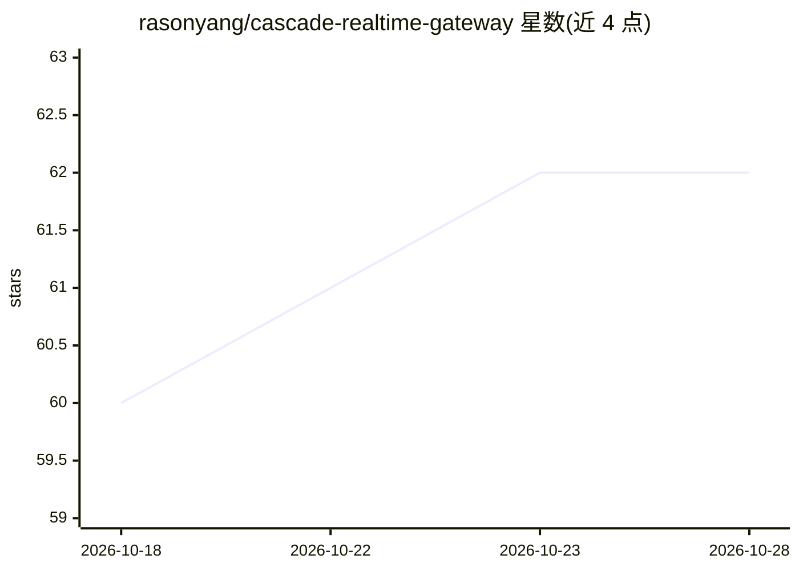

# rasonyang/cascade-realtime-gateway

⭐ 62 · Go · Apache-2.0 · 推送 2026-10-12 · [GitHub](https://github.com/rasonyang/cascade-realtime-gateway) · 个人维护

**自托管语音网关：OpenAI Realtime 协议后接 ASR→LLM→TTS 级联**

用 Go 编写的单个二进制语音网关，对客户端呈现 OpenAI Realtime (GA) WebSocket 协议，后端运行 ASR→LLM→TTS 级联流水线。后端各环节以 provider 实例配置（Deepgram、OpenAI、Qwen、mock），通过 Admin REST API 在运行时切换 profile，客户端无需改动。实现轮次检测、barge-in 中断取消、上下文裁剪、流式合成与函数调用转发。限制：非原生 speech-to-speech、仅实现协议子集、不支持 WebRTC/SIP、单 API key 鉴权、无数据库。需 Go 1.25+ 从源码构建。

## 筛选速览

| 维度 | 判定 | 备注 |
|---|---|---|
| AI 角色 | `ai-ecosystem` | LLM/agent 周边工具 |
| 许可风险 | `permissive` | Apache-2.0 |
| 部署形态 | `None` |  |
| 模型依赖 | — | README 未给出锁定关系 |
| 硬件要求 | — | 无带数字的原话,不猜 |
| 安装摩擦 | `low` | 无编译、无系统依赖或容器化 |
| 成熟度 | — | 结构信号不足 |

## 能力要点

- 客户端面向 OpenAI Realtime GA 协议，后端 ASR/LLM/TTS 独立配置替换
- Admin REST API 运行时切换 provider profile，新连接生效
- 内置确定性 mock provider，无 API key 即可跑通全流程
- 处理 barge-in、VAD 轮次检测、截断后上下文裁剪与工具调用片段重组

## 适用场景

- 已有 OpenAI Realtime 客户端，想换用自托管或多供应商后端
- 按语言/地区/成本/延迟逐项选择 ASR、LLM、TTS 供应商
- 构建语音 agent 或电话桥接，需要一个可检视的小型网关

## 场景标签

`语音 Agent` `模型网关` · 领域:Agent 开发

## 证据(README 行号)

> L3: A self-hosted voice gateway that speaks the OpenAI Realtime (GA) WebSocket protocol to clients and
> L6: The client-facing protocol stays fixed. The ASR, LLM and TTS vendors behind it are configuration, and
> L41: - The backend stack is a named *profile* — one ASR, one LLM, one TTS instance — changed through an

## 星数曲线

2026-10-18 60 → 2026-10-28 62（+2）

---
*卡片 v1 · prompt 1.4 · 生成 2026-10-24 · 置信度 high · 依据 README sha `d6976381f985` · [字段定义](../../DATASET.md)*
