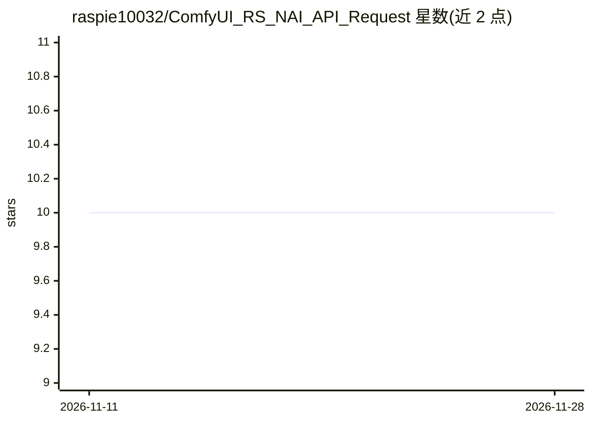

# raspie10032/ComfyUI_RS_NAI_API_Request

⭐ 10 · Python · NOASSERTION · 推送 2026-11-25 · [GitHub](https://github.com/raspie10032/ComfyUI_RS_NAI_API_Request) · 个人维护

**ComfyUI 节点：通过 NovelAI API 生成与修整多角色图像**

一套 ComfyUI 自定义节点，接入 NovelAI Diffusion V5 及更早模型的 API，支持 txt2img、img2img、inpainting、Vibe Transfer、Precise Reference、多角色提示词与权重语法转换。内置 Detailer 可按多个区域顺序执行 bbox+SAM/SEGM 检测与修整，附带本地 PyTorch WD tagger 将各区域自动匹配到原始角色提示词（tagger 结果仅用于匹配，不进入生成提示词）。提供相机控制节点生成视点描述，并可与作者另一扩展 RS Multi-Character Sampler 共享角色/上下文管道。

## 筛选速览

| 维度 | 判定 | 备注 |
|---|---|---|
| AI 角色 | `ai-native` | 本体是模型或模型工具 |
| 许可风险 | `none` | NOASSERTION |
| 部署形态 | `library` | 以包/库形式分发 |
| 模型依赖 | — | README 未给出锁定关系 |
| 硬件要求 | — | 无带数字的原话,不猜 |
| 安装摩擦 | `low` | 无编译、无系统依赖或容器化 |
| 成熟度 | — | 结构信号不足 |

## 能力要点

- 支持 txt2img、img2img、inpainting、Vibe Transfer、Precise Reference 与提示词权重转换
- 多角色 Detailer 顺序处理多区域，最多 22 角色 / 64 区域，默认最多 5 区域
- 本地 PyTorch WD tagger 自动将区域匹配到角色与作品名，无需 ONNX runtime
- 生成后以英文/韩文/日文显示最后一次成功请求的只读摘要

## 适用场景

- 在 ComfyUI 工作流中调用 NovelAI API 生成多角色图像
- 对生成图中的人脸/角色区域逐个检测并修复
- 从 PNG/WebP 恢复提示词、角色位置与生成设置以复用工作流
- 本地与 NovelAI 之间往返共享角色提示词与坐标

## 场景标签

`图像生成` `图像视频处理` · 领域:内容生成

## 证据(README 行号)

> L3: ComfyUI custom nodes for **NovelAI Diffusion V5 and earlier models**, supporting text-to-image generation, img2img, 
> L5: The Detailer can use bbox+SAM, native SEGM masks, or a standard ComfyUI `MASK` from SAM3 or another mask node, and c

## 星数曲线

2026-11-11 10 → 2026-11-28 10（+0）

---
*卡片 v1 · prompt 1.4 · 生成 2026-11-19 · 置信度 low · 依据 README sha `b793d0922f9a` · [字段定义](../../DATASET.md)*
