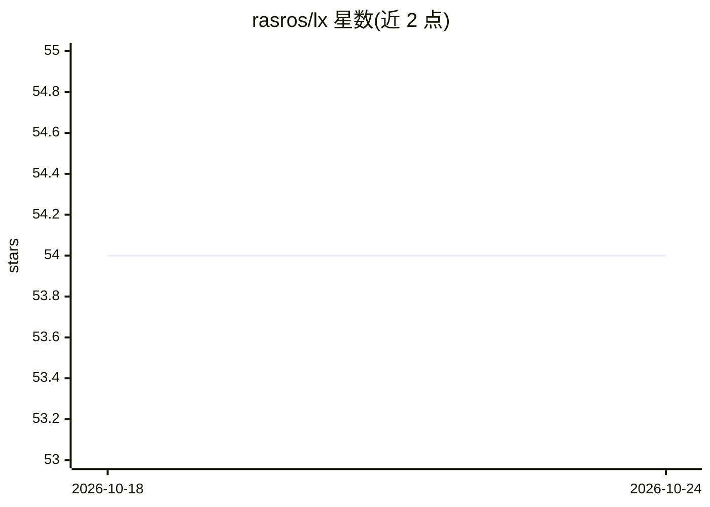

# rasros/lx

⭐ 54 · Go · MIT · 推送 2026-10-23 · [GitHub](https://github.com/rasros/lx) · 个人维护

**将项目文件打包为 LLM 提示词上下文的 Go CLI 工具**

面向开发者的命令行工具：遍历目录生成可粘贴给 LLM 的上下文，遵守 .gitignore/.ignore/.lxignore，跳过隐藏文件与二进制，输出 Markdown/XML/HTML/纯文本并附带 token 估算。支持 include/exclude glob、按 section 分组的流式参数解析、从 stdin 读路径以便与 git diff/fzf 组合、URL 直接拉取远端仓库、展开压缩包、提取 PDF/Office 文本与媒体元数据。通过 go install 或 install.sh 安装，剪贴板功能在 Linux 需要 xclip 或 wl-clipboard。

## 筛选速览

| 维度 | 判定 | 备注 |
|---|---|---|
| AI 角色 | `ai-ecosystem` | LLM/agent 周边工具 |
| 许可风险 | `permissive` | MIT |
| 部署形态 | `library` | 以包/库形式分发 |
| 模型依赖 | — | README 未给出锁定关系 |
| 硬件要求 | — | 无带数字的原话,不猜 |
| 安装摩擦 | `low` | 无编译、无系统依赖或容器化 |
| 成熟度 | — | 结构信号不足 |

## 能力要点

- 多格式输出（Markdown/XML/HTML/bare）并附带 token 估算
- 尊重 .gitignore/.ignore/.lxignore，跳过二进制与隐藏文件
- 支持 URL 直接打包 GitHub/GitLab/Bitbucket/Codeberg 仓库
- -D/-M 从 PDF、Office 文档与媒体文件提取文本或元数据

## 适用场景

- 把整个项目或选定文件整理成一段提示词粘贴给 LLM
- 与 git diff、fd、fzf 组合选择文件后打包上下文
- 为 Claude/OpenCode 等 coding agent 安装 lx 使用技能

## 场景标签

`提示工程` · 领域:Agent 开发

## 证据(README 行号)

> L6: lx turns a pile of files into one prompt you can paste into an LLM.
> L50: lx -p "Explain this project structure" src/ | llm

## 星数曲线

2026-10-18 54 → 2026-10-24 54（+0）

---
*卡片 v1 · prompt 1.4 · 生成 2026-10-24 · 置信度 high · 依据 README sha `7fd8c156502b` · [字段定义](../../DATASET.md)*
