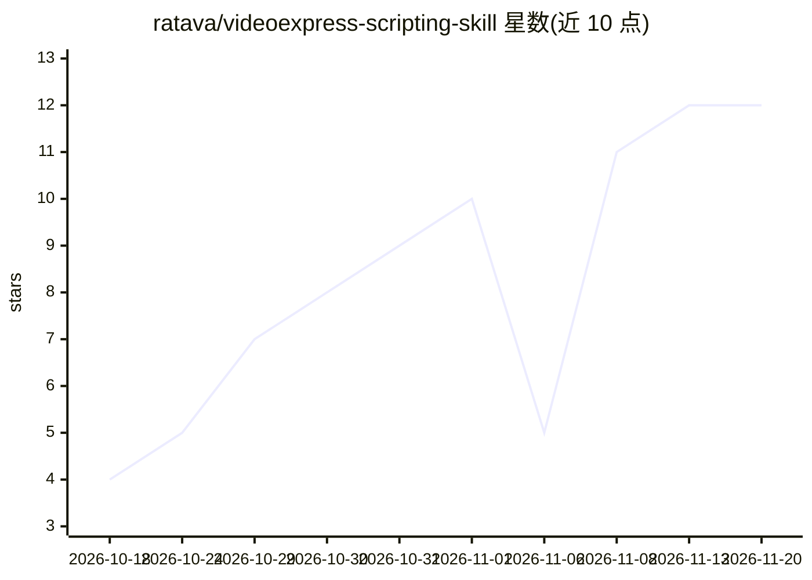

# ratava/videoexpress-scripting-skill

⭐ 12 · JavaScript · NOASSERTION · 推送 2026-11-17 · [GitHub](https://github.com/ratava/videoexpress-scripting-skill) · 个人维护

**为 Agent 编写 VideoExpress 多片段 AI 视频提示包的技能**

面向 VideoExpress 3.5 的 Agent Skill：将歌曲、故事或旁白转化为逐镜头提示包，包含起始图像提示、VE 多镜头视频提示、时长与生成质检清单。内容按 references 文件夹组织，SKILL.md 作路由，按需读取项目访谈、提示模板、镜头与运动、灯光声音对白、失败修复与风格表等文件。提供 Claude 与 ChatGPT 两套构建，Grok/Gemini/DeepSeek 复用平台中立的 ChatGPT 构建，遵循开放 Agent Skills 标准。为独立社区技能，非 VideoExpress 官方出品，采用 CC BY-NC 4.0 非商业许可。

## 筛选速览

| 维度 | 判定 | 备注 |
|---|---|---|
| AI 角色 | `ai-knowledge` | 知识聚合/清单类 |
| 许可风险 | `none` | NOASSERTION |
| 部署形态 | `None` |  |
| 模型依赖 | locked-api |  |
| 硬件要求 | — | 无带数字的原话,不猜 |
| 安装摩擦 | `low` | 无编译、无系统依赖或容器化 |
| 成熟度 | — | 结构信号不足 |

## 能力要点

- 将歌曲/故事/旁白转化为逐镜头提示包（起始图提示、多镜头提示、时长、QC 清单）
- 67 种 Creative mode 风格表，每种含风格锚点、稳定性描述、防护与已知失败
- 跨片段连续性机制：角色/服装/场景块、Consistent Character 参考槽、切帧衔接
- 失败模式修复方法：单变量测试镜头与对照隔离顽固失败

## 适用场景

- 在 Claude/ChatGPT 等Agent 工具中规划多片段 AI 视频项目
- 为 VideoExpress 生成分镜头脚本与提示词包
- 排查视频生成中镜头漂移、角色变形等失败情况

## 场景标签

`提示工程` · 领域:Agent 开发

## 证据(README 行号)

> L1: # VideoExpress Scripting — an Agent Skill
> L3: An Agent Skill for planning and scripting multi-clip AI videos in **VideoExpress 3.5 and later** by PaulPonna.com. I
> L20: The skill follows the open Agent Skills standard, so the same core method runs in Claude, ChatGPT, Grok, Gemini and

## 星数曲线

2026-10-18 4 → 2026-11-20 12（+8）

---
*卡片 v1 · prompt 1.4 · 生成 2026-11-18 · 置信度 high · 依据 README sha `a6e08a956a04` · [字段定义](../../DATASET.md)*
