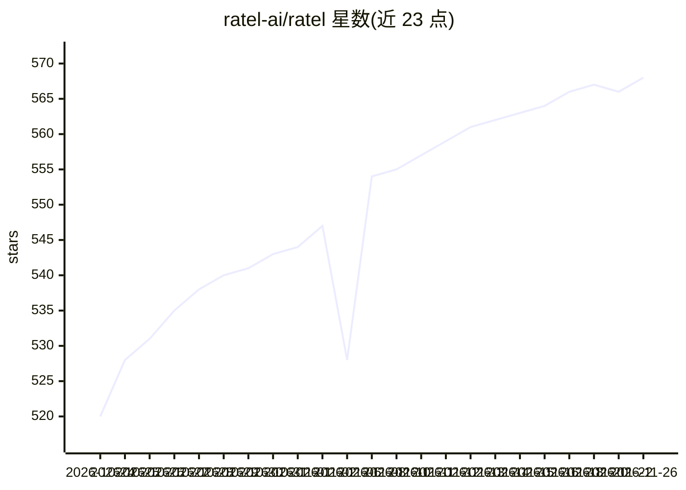

# ratel-ai/ratel

⭐ 568 · TypeScript · MIT · 推送 2026-11-25 · [GitHub](https://github.com/ratel-ai/ratel) · [官网](https://www.ratel.sh/) · 组织维护

**自托管 AI agent 追踪分析与评测平台，帮助开发者发现 agent 失败点**

自托管平台：agent 通过 OTLP/SDK 上报 traces、工具与技能目录，平台基于 Postgres 作业队列计算 agent 健康信号、工作流、自纠正、主题聚类、意图图与工具匹配质量等读数，并在发布前对真实会话跑评测。无模型 key 时不发起外呼，需模型的读数自行报告跳过。由单应用加一个 Postgres 组成，无独立 worker；提供 TypeScript 与 Python SDK，并经 MCP 端点供 agent 查询。

## 筛选速览

| 维度 | 判定 | 备注 |
|---|---|---|
| AI 角色 | `ai-ecosystem` | LLM/agent 周边工具 |
| 许可风险 | `permissive` | MIT |
| 部署形态 | `self-host` | docker 或自建部署 |
| 模型依赖 | — | README 未给出锁定关系 |
| 硬件要求 | — | 无带数字的原话,不猜 |
| 安装摩擦 | `low` | 无编译、无系统依赖或容器化 |
| 成熟度 | — | 结构信号不足 |

## 能力要点

- 读取 agent traces 并生成健康信号、意图图、工具匹配质量等读数
- 一个应用加一个 Postgres 自托管，无独立 worker/scheduler
- 无模型 key 时不发起任何外呼，需模型读数自行跳过
- 提供 MCP 端点，附带 Claude Code/Cursor 等 MCP 客户端配置

## 适用场景

- 在自有基础设施上观测自建 agent 的行为与失败点
- 在发布修复前对真实会话运行评测验证
- 让 agent 经 MCP 查询自身的运行数据

## 场景标签

`LLM 可观测性` `模型评测` · 领域:评测与运维

## 证据(README 行号)

> L16: Ratel is a self-hosted platform for AI agents. Your agent sends it traces and its catalog of tools and skills. Rate
> L18: It is for anyone building or running an agent who wants to see how it behaves and keep that data on their own machi
> L21: - **Ingest and catalog APIs:** OTLP traces and logs, SDK events, catalog pull, skills and intent graph sync, authen

## 星数曲线

2026-10-24 520 → 2026-11-26 568（+48）

---
*卡片 v1 · prompt 1.4 · 生成 2026-11-25 · 置信度 high · 依据 README sha `c3a3592854d4` · [字段定义](../../DATASET.md)*
