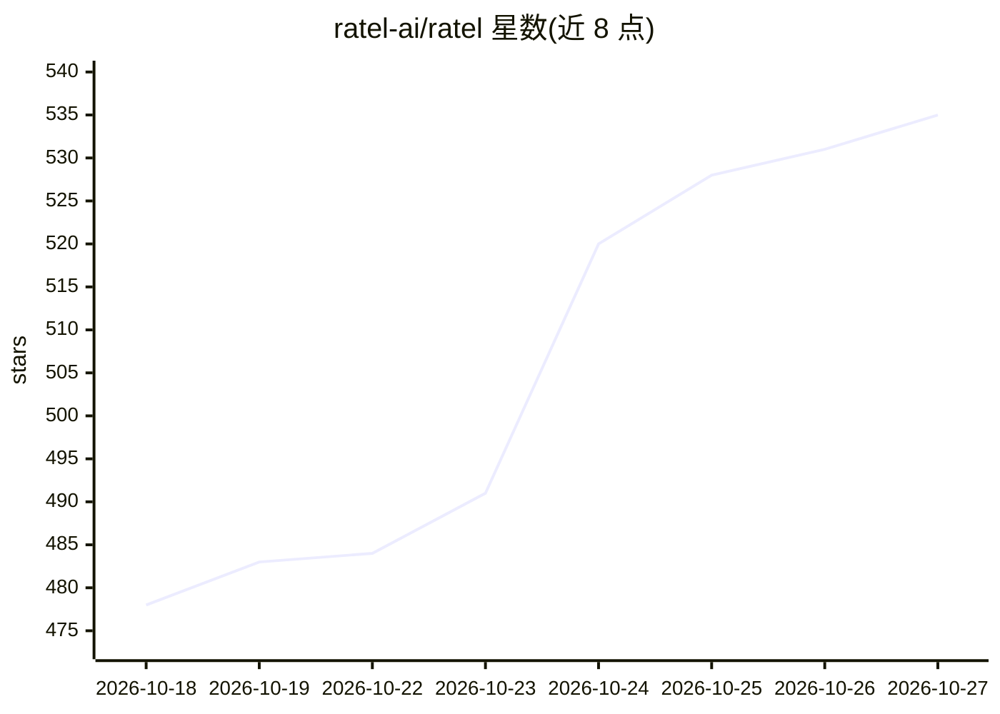

# ratel-ai/ratel

⭐ 535 · Rust · MIT · 推送 2026-10-26 · [GitHub](https://github.com/ratel-ai/ratel) · [官网](https://www.ratel.sh/) · 组织维护

**AI agent 的上下文工程层：按轮次检索注入相关工具与技能，减少 token**

面向 AI agent 开发者的上下文工程库：将工具与技能建为索引目录，agent 通过 search_capabilities 按轮次检索，仅注入匹配能力而非全量加载，以缓解工具过载导致的精度下降并减少 token 开销；固定背景信息注册为 facts，仅在对话中不新鲜时重新注入。默认 BM25 检索，无需向量库；语义/混合排序可选，支持进程内模型或 OpenAI 兼容嵌入端点。核心为 Rust 引擎，提供 TypeScript（NAPI）与 Python SDK。

## 筛选速览

| 维度 | 判定 | 备注 |
|---|---|---|
| AI 角色 | `ai-ecosystem` | LLM/agent 周边工具 |
| 许可风险 | `permissive` | MIT |
| 部署形态 | `library` | 以包/库形式分发 |
| 模型依赖 | — | README 未给出锁定关系 |
| 硬件要求 | — | 无带数字的原话,不猜 |
| 安装摩擦 | `low` | 无编译、无系统依赖或容器化 |
| 成熟度 | — | 结构信号不足 |

## 能力要点

- 工具/技能目录 + 渐进披露，按轮次检索注入匹配能力
- 默认 BM25，无需向量数据库，检索快速且确定性
- 语义与混合排序可选，支持进程内模型或 OpenAI 兼容嵌入端点
- facts 机制管理固定背景信息，仅在上下文中不新鲜时重新注入

## 适用场景

- 工具数量过多的 agent 精简每轮上下文、控制 token 成本
- 为 MCP 工具集添加按需检索层（ratel-local）
- 让 skill 指令按需加载而非全量注入系统提示

## 场景标签

`Agent 记忆` · 领域:Agent 开发

## 证据(README 行号)

> L19: The context engineering layer for AI agents. Selects only the tools and skills relevant to each turn, recovering ac
> L73: The indexes use BM25 by default, the same algorithm behind most search engines, applied to each tool's name, descri

## 星数曲线

2026-10-18 478 → 2026-10-27 535（+57）

---
*卡片 v1 · prompt 1.4 · 生成 2026-10-21 · 置信度 high · 依据 README sha `764d7f64b5fe` · [字段定义](../../DATASET.md)*
