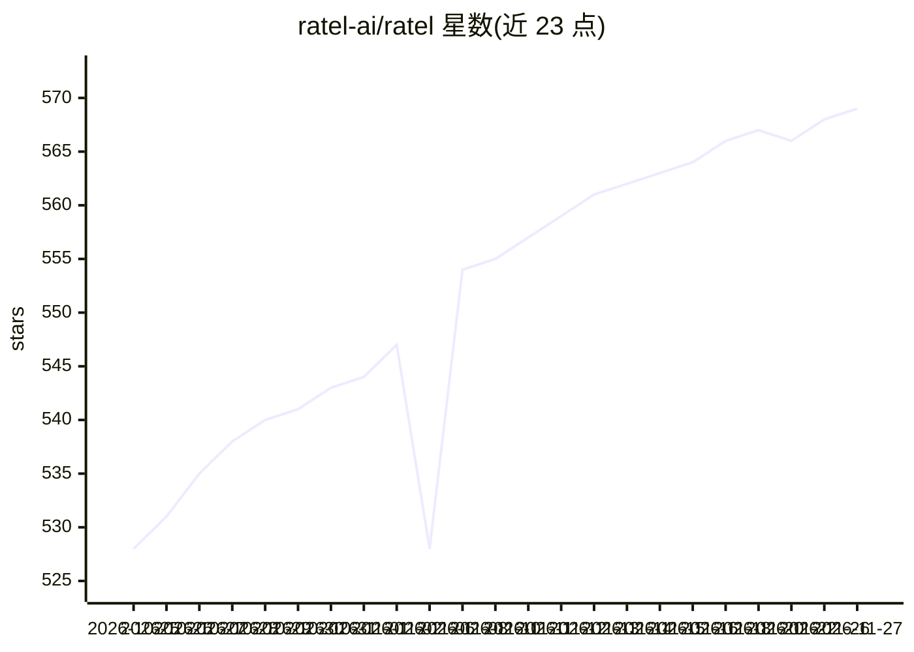

# ratel-ai/ratel

⭐ 569 · TypeScript · MIT · 推送 2026-11-26 · [GitHub](https://github.com/ratel-ai/ratel) · [官网](https://www.ratel.sh/) · 组织维护

**自托管平台：审计 agent 运行轨迹并评测修复建议**

自托管的 AI agent 观测与改进平台：agent 上报 OTLP 轨迹、工具与技能目录，Ratel 从中给出健康信号、工作流与自纠正、话题、意图聚类、工具匹配质量等读数，并可在真实会话上跑评测验证修复。由控制台、摄取/目录 API、Postgres 队列后台任务组成，单应用加单 Postgres 即可运行，无需独立 worker。模型 key 可选，无 key 时不发起外部模型调用，需模型的读数自行标记跳过。提供 TypeScript 与 Python SDK，并经 MCP 暴露查询工具。

## 筛选速览

| 维度 | 判定 | 备注 |
|---|---|---|
| AI 角色 | `ai-ecosystem` | LLM/agent 周边工具 |
| 许可风险 | `permissive` | MIT |
| 部署形态 | `self-host` | docker 或自建部署 |
| 模型依赖 | — | README 未给出锁定关系 |
| 硬件要求 | — | 无带数字的原话,不猜 |
| 安装摩擦 | `low` | 无编译、无系统依赖或容器化 |
| 成熟度 | — | 结构信号不足 |

## 能力要点

- 读取 agent 轨迹与工具/技能目录，输出健康信号、意图图、工具匹配质量等读数
- 自托管：单应用加单 Postgres，后台任务内置，无需独立 worker 或调度器
- 模型 key 可选，无 key 时不做外部模型调用
- 提供 TypeScript 与 Python SDK，并支持通过 MCP 接入 agent 查询

## 适用场景

- 在自建基础设施上观测 agent 的行为与失败模式
- 发布前在真实会话上评测修复是否有效
- 将 agent 接入 MCP，让 agent 查询自己的运行数据

## 场景标签

`LLM 可观测性` `模型评测` · 领域:评测与运维

## 证据(README 行号)

> L16: Ratel is a self-hosted platform for AI agents. Your agent sends it traces and its catalog of tools and skills. Rate
> L18: It is for anyone building or running an agent who wants to see how it behaves and keep that data on their own machi
> L23: - **Readings:** what Ratel works out from the traffic, as jobs over a ledger of your agent's turns: Agent health si

## 星数曲线

2026-10-25 528 → 2026-11-27 569（+41）

---
*卡片 v1 · prompt 1.4 · 生成 2026-11-26 · 置信度 high · 依据 README sha `02f8cd308f00` · [字段定义](../../DATASET.md)*
