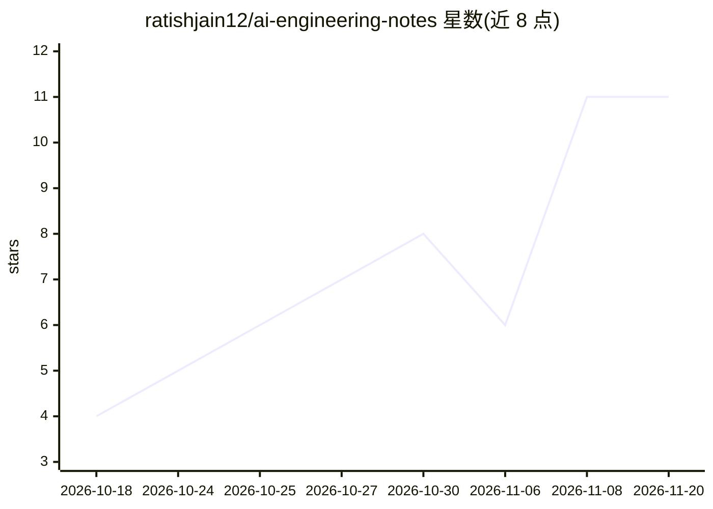

# ratishjain12/ai-engineering-notes

⭐ 11 · JavaScript · MIT · 推送 2026-11-16 · [GitHub](https://github.com/ratishjain12/ai-engineering-notes) · [官网](https://learn.ratishfolio.com) · 个人维护

**AI 工程主题的公开学习笔记站，逐题记录理解与资源**

作者以 learning-in-public 方式逐个撰写 AI 工程主题笔记，记录自己的理解与所用资源，无固定课程大纲。现有内容覆盖 LLM（注意力、KV Cache、投机解码、量化、微调、MoE）与 Agent（工具调用、上下文工程、记忆、规划、MCP、人机协同、多智能体、可靠性）等 15 个主题。站点基于 Astro Starlight 构建，部署于 Cloudflare Pages（域名指向 live site），代码 MIT、笔记 CC BY 4.0。

## 筛选速览

| 维度 | 判定 | 备注 |
|---|---|---|
| AI 角色 | `ai-knowledge` | 知识聚合/清单类 |
| 许可风险 | `permissive` | MIT |
| 部署形态 | `None` |  |
| 模型依赖 | — | README 未给出锁定关系 |
| 硬件要求 | — | 无带数字的原话,不猜 |
| 安装摩擦 | `low` | 无编译、无系统依赖或容器化 |
| 成熟度 | — | 结构信号不足 |

## 能力要点

- 15 个主题笔记：LLM 底层（Attention/KV Cache/量化/微调/MoE）到 Agent 工程（MCP/记忆/规划/多智能体）
- 学习笔记形式：记录个人理解与所用资源，无固定大纲
- 代码 MIT、笔记内容 CC BY 4.0 双许可声明
- 线上站点 learn.ratishfolio.com 可直接访问

## 适用场景

- 系统学习 LLM 推理与微调等 AI 工程概念
- 按主题查阅 Agent 开发要点（工具调用、上下文工程、可靠性）
- 参考他人 AI 工程学习路径与资料清单

## 场景标签

`教程课程` · 领域:学习与行业

## 证据(README 行号)

> L5: I write up one AI engineering topic at a time: what I understood and the resources I used. No fixed syllabus. The ne
> L11: ## Topics

## 星数曲线

2026-10-18 4 → 2026-11-20 11（+7）

---
*卡片 v1 · prompt 1.4 · 生成 2026-11-18 · 置信度 high · 依据 README sha `45ff53251e1a` · [字段定义](../../DATASET.md)*
