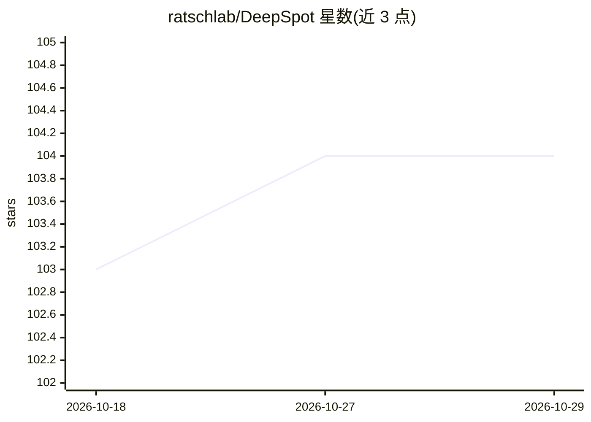

# ratschlab/DeepSpot

⭐ 104 · Jupyter Notebook · MIT · 推送 2026-10-26 · [GitHub](https://github.com/ratschlab/DeepSpot) · [官网](https://www.medrxiv.org/content/10.1101/2025.02.09.25321567v3) · 组织维护

**从 H&E 病理图像预测空间转录组的深度学习模型**

DeepSpot 是一个深度学习模型与 Python 工具包，从 H&E 组织病理图像预测空间转录组数据，支持 spot 级（Visium）与单细胞级（Xenium，DeepCell 版本）两种分辨率。机制上采用 deep-set 神经网络，将 spot 建模为子 spot 的集合，结合预训练病理基础模型（UNI/H-optimus-0/Phikon，权重需另行下载）提取特征并整合空间上下文，通过基因预测头输出空间基因表达。提供预训练权重、教程 notebook，并公开发布 3780 例 TCGA 样本、超 5600 万 spots 的预测空间转录组数据（约 7TB，经 Hugging Face 分发）。安装为 git clone 加 conda 环境与 setup.py，需额外安装 pyvips。

## 筛选速览

| 维度 | 判定 | 备注 |
|---|---|---|
| AI 角色 | `ai-native` | 本体是模型或模型工具 |
| 许可风险 | `permissive` | MIT |
| 部署形态 | `library` | 以包/库形式分发 |
| 模型依赖 | — | README 未给出锁定关系 |
| 硬件要求 | — | 无带数字的原话,不猜 |
| 安装摩擦 | `low` | 无编译、无系统依赖或容器化 |
| 成熟度 | — | 结构信号不足 |

## 能力要点

- 从 H&E 图像预测空间基因表达，支持 Visium spot 级与 Xenium 单细胞级
- 基于预训练病理基础模型（UNI/H-optimus-0/Phikon）与空间上下文建模
- 提供预训练权重与训练/推理教程 notebook
- 公开 3780 例 TCGA、超 5600 万 spots 的预测空间转录组数据

## 适用场景

- 病理切片的虚拟空间转录组生成，无需实际测序
- 肿瘤研究中补充 TCGA 等样本的基因表达空间信息
- 在 Visium/Xenium 数据上训练或用预训练模型做推断

## 场景标签

 · 领域:生物信息学/计算病理学

## 证据(README 行号)

> L42: We introduce DeepSpot, a novel deep-learning model that predicts spatial transcriptomics from H&E images. DeepSpot 
> L47: **Workflow of DeepSpot**: H&E slides are first divided into tiles, each corresponding to a spot. For each spot, we 

## 星数曲线

2026-10-18 103 → 2026-10-29 104（+1）

---
*卡片 v1 · prompt 1.4 · 生成 2026-10-23 · 置信度 mid · 依据 README sha `c49df5968ebe` · [字段定义](../../DATASET.md)*
