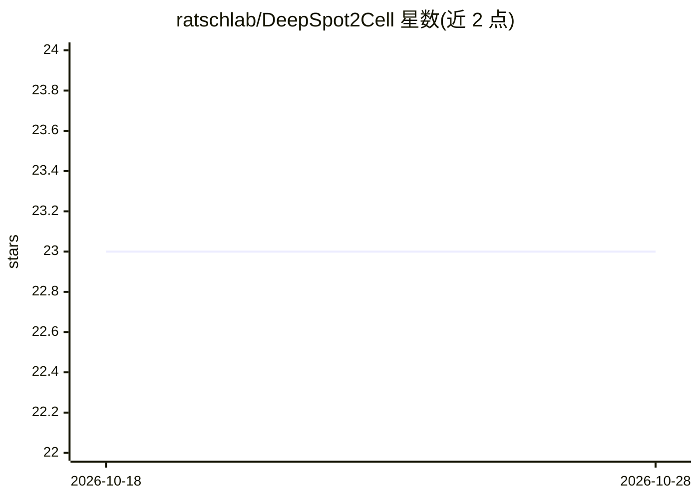

# ratschlab/DeepSpot2Cell

⭐ 23 · Python · MIT · 推送 2026-10-26 · [GitHub](https://github.com/ratschlab/DeepSpot2Cell) · [官网](https://www.biorxiv.org/content/10.1101/2025.09.23.678121v3) · 组织维护

**从 H&E 病理图像预测虚拟单细胞空间转录组的深度学习模型**

DeepSpot2Cell 是一个基于 PyTorch 的计算病理学模型：训练时以分割掩码定义的细胞切片、覆盖该细胞的 55μm spot 切片及邻近 spot 切片为输入，先经病理基础模型（PFM）处理，再回归 spot 级基因表达；推理时仅用细胞切片即可预测细胞级虚拟转录组。支持 UNI、Hoptimus0、Phikon v2 等基础模型权重，配合 HEST-1k 数据集使用，提供预处理/训练/推理三部分教程 notebook。需 Python 3.9+，通过 conda 环境与 pip 源码方式安装。

## 筛选速览

| 维度 | 判定 | 备注 |
|---|---|---|
| AI 角色 | `ai-native` | 本体是模型或模型工具 |
| 许可风险 | `permissive` | MIT |
| 部署形态 | `library` | 以包/库形式分发 |
| 模型依赖 | — | README 未给出锁定关系 |
| 硬件要求 | — | 无带数字的原话,不猜 |
| 安装摩擦 | `low` | 无编译、无系统依赖或容器化 |
| 成熟度 | — | 结构信号不足 |

## 能力要点

- 从 H&E 图像经 PFM 特征预测细胞级虚拟空间转录组
- 支持 UNI / Hoptimus0 / Phikon v2 等病理基础模型
- 提供预处理、训练、推理三部分教程 notebook
- 配套 HEST-1k 数据集使用

## 适用场景

- 从常规 H&E 染色切片预测单细胞分辨率基因表达
- 空间转录组学研究中做细胞级去卷积与表达预测
- 数字病理分析中结合基础模型做训练与推理

## 场景标签

 · 领域:生物信息学/计算病理学

## 证据(README 行号)

> L13: **DeepSpot2Cell predicts virtual single-cell spatial transcriptomics as follows:** (1) During training, the model t
> L43: DeepSpot2Cell can be used with different pathology foundation models. The ones it was tested with can be found at t

## 星数曲线

2026-10-18 23 → 2026-10-28 23（+0）

---
*卡片 v1 · prompt 1.4 · 生成 2026-10-27 · 置信度 mid · 依据 README sha `1c974bea4562` · [字段定义](../../DATASET.md)*
