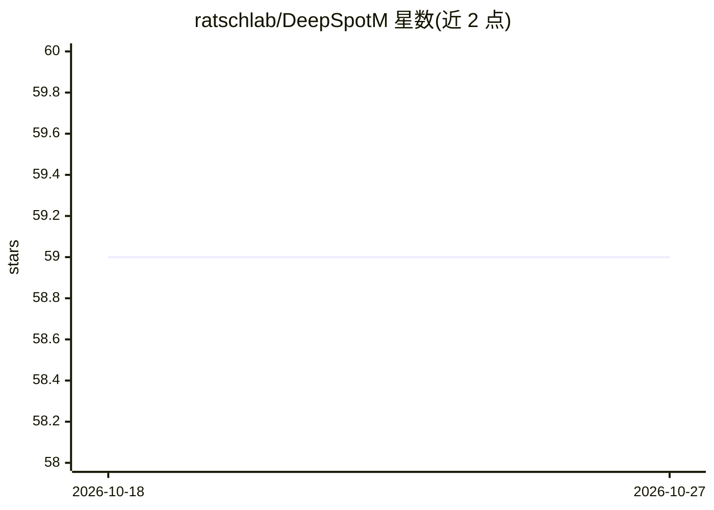

# ratschlab/DeepSpotM

⭐ 59 · Python · NOASSERTION · 推送 2026-09-04 · [GitHub](https://github.com/ratschlab/DeepSpotM) · [官网](https://doi.org/10.64898/2026.06.19.26356060 ) · 组织维护

**从 H&E 组织学图像预测全转录组空间基因表达的多模态基础模型**

面向计算病理学与生物信息研究者的深度学习模型：将 224x224 H&E 图块经 LoRA 适配的病理基础骨干（Midnight）编码，通过交叉注意力基因解码器与基因路由超网络（融合 DNA/RNA/蛋白/单细胞/文本基础模型的冻结生物嵌入）预测约 19k 基因的空间表达，支持对训练中未见过的基因做零样本预测。以 Python 包（pip）与命令行脚本提供，可读取全切片生成 AnnData（.h5ad）。声明仅供研究使用，非临床/诊断用途；采用 PolyForm NC 分拆许可。

## 筛选速览

| 维度 | 判定 | 备注 |
|---|---|---|
| AI 角色 | `ai-native` | 本体是模型或模型工具 |
| 许可风险 | `none` | NOASSERTION |
| 部署形态 | `library` | 以包/库形式分发 |
| 模型依赖 | — | README 未给出锁定关系 |
| 硬件要求 | — | 无带数字的原话,不猜 |
| 安装摩擦 | `low` | 无编译、无系统依赖或容器化 |
| 成熟度 | — | 结构信号不足 |

## 能力要点

- 图块到空间基因表达的全转录组预测（约 19k 基因）
- 基因以可查询嵌入表示，支持对未见基因的零样本预测
- 整片 WSI 自动切片、背景过滤并输出 scanpy/squidpy 兼容的 .h5ad
- 附带 TCGA 28,664 张切片、32 种癌症的虚拟空间转录组图谱数据集

## 适用场景

- 从 H&E 切片生成虚拟空间转录组数据
- 对指定标志基因（如 BRAF、EPCAM）做空间表达预测
- 下载并分析已发布的 TCGA 虚拟空间转录组图谱

## 场景标签

`多模态` `科研工具` · 领域:学习与行业

## 证据(README 行号)

> L22: We introduce DeepSpot-M, a multimodal foundation model that maps a histology image tile to
> L34: **Fig. DeepSpot-M predicts transcriptome-wide spatial gene expression from histology.**

## 星数曲线

2026-10-18 59 → 2026-10-27 59（+0）

---
*卡片 v1 · prompt 1.4 · 生成 2026-10-24 · 置信度 high · 依据 README sha `b0a34cd49a99` · [字段定义](../../DATASET.md)*
