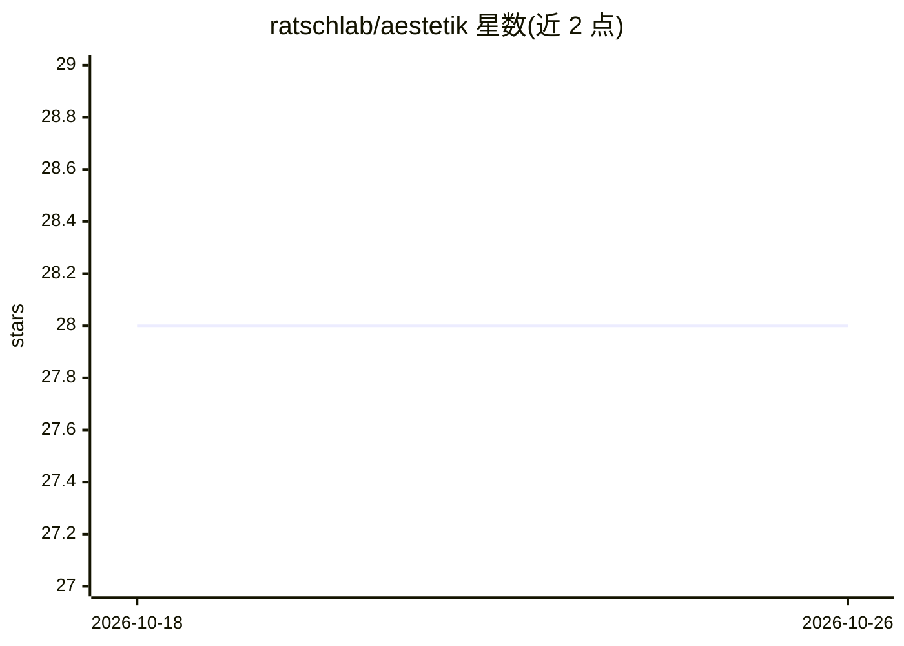

# ratschlab/aestetik

⭐ 28 · Jupyter Notebook · MIT · 推送 2026-08-18 · [GitHub](https://github.com/ratschlab/aestetik) · [官网](https://academic.oup.com/bioinformatics/advance-article/doi/10.1093/bioinformatics/btag316/8692433) · 组织维护

**从空间转录组与形态学图像学习点级表示的卷积自编码器**

AESTETIK 是论文 “Representation learning for multi-modal spatially resolved transcriptomics data” 配套的卷积自编码器模型，面向空间生物学与计算病理学研究者。它在点级联合整合转录组与形态学信息，在邻域级整合拓扑信息，通过 PCA、模态内聚类得到多三元组损失标签，再经拼接融合与网格构建输入自编码器，产出用于聚类、形态学分析等下游任务的点表示。提供 scikit-learn 风格的 fit/transform/predict 接口，可通过 pip/conda/源码安装，形态学点提取需 pyvips。

## 筛选速览

| 维度 | 判定 | 备注 |
|---|---|---|
| AI 角色 | `ai-native` | 本体是模型或模型工具 |
| 许可风险 | `permissive` | MIT |
| 部署形态 | `library` | 以包/库形式分发 |
| 模型依赖 | — | README 未给出锁定关系 |
| 硬件要求 | — | 无带数字的原话,不猜 |
| 安装摩擦 | `low` | 无编译、无系统依赖或容器化 |
| 成熟度 | — | 结构信号不足 |

## 能力要点

- 联合转录组、形态学与空间拓扑的多模态点表示学习
- scikit-learn 风格 fit/transform/predict 估计器接口
- 支持 Harmony、scVI 等方式的跨样本整合
- 提供 pyvips 形态学辅助、可视化与测试可选扩展

## 适用场景

- 对空间转录组数据做空间感知的聚类与下游分析
- 整合 H&E 图像与转录组数据获取点级表示
- 多样本空间转录组数据的跨样本对齐与整合

## 场景标签

 · 领域:生物信息学/空间生物学

## 证据(README 行号)

> L8: This model is part of the paper "Representation learning for multi-modal spatially resolved transcriptomics data".
> L27: We introduce AESTETIK, a convolutional autoencoder model. It jointly integrates transcriptomics and morphology info
> L32: **A**: Spatial transcriptomics enables in-depth molecular characterization of samples on a morphology and RNA level

## 星数曲线

2026-10-18 28 → 2026-10-26 28（+0）

---
*卡片 v1 · prompt 1.4 · 生成 2026-10-26 · 置信度 high · 依据 README sha `a4c68f92e150` · [字段定义](../../DATASET.md)*
