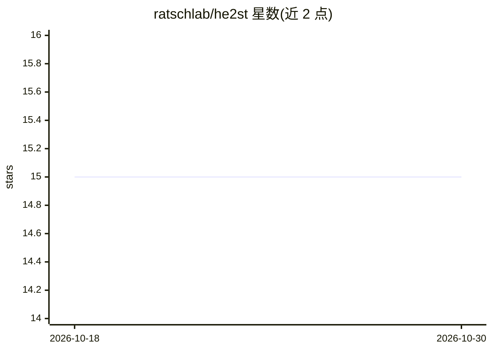

# ratschlab/he2st

⭐ 15 · Jupyter Notebook · MIT · 推送 2026-05-12 · [GitHub](https://github.com/ratschlab/he2st) · [官网](https://www.medrxiv.org/content/10.1101/2025.02.09.25321567v1) · 组织维护

**从 H&E 病理图像预测空间转录组的论文代码（DeepSpot）**

论文 DeepSpot 的官方代码仓库：训练模型从 H&E 染色病理图像预测约 5,000 个基因的空间转录组表达，利用病理基础模型特征与多层级组织空间上下文；支持从头预测、校正已有空间转录组数据及 TCGA 切片推理。以 Snakemake 流水线形式提供预处理、训练评估、基因校正与 TCGA 标注流程，需 conda 环境、病理基础模型权重及 SLURM 集群（sbatch）配置，数据来自 HEST-1K、Xenium、Visium 等公开来源，模型权重托管于 Zenodo。面向计算病理学与生物信息研究者复现和扩展论文结果。

## 筛选速览

| 维度 | 判定 | 备注 |
|---|---|---|
| AI 角色 | `ai-native` | 本体是模型或模型工具 |
| 许可风险 | `permissive` | MIT |
| 部署形态 | `None` |  |
| 模型依赖 | — | README 未给出锁定关系 |
| 硬件要求 | — | 无带数字的原话,不猜 |
| 安装摩擦 | `low` | 无编译、无系统依赖或容器化 |
| 成熟度 | — | 结构信号不足 |

## 能力要点

- 从 H&E 图像预测 5,000 基因空间转录组并支持校正已有数据
- Snakemake 流水线覆盖预处理、评估、基因校正与 TCGA 推理
- 已生成 3,780 个 TCGA 空间转录组样本（超 5,600 万 spots）
- 训练权重与预测数据公开托管于 Zenodo 与 DeepSpot 仓库

## 适用场景

- 复现论文的空间转录组预测与评估流程
- 对我自己的 H&E 切片运行模型预测或校正空间转录组数据
- 基于 TCGA 切片生成伪空间转录组用于下游分析

## 场景标签

`科研工具` · 领域:学习与行业

## 证据(README 行号)

> L3: This repository contains the code of the paper "DeepSpot: Leveraging Spatial Context for Enhanced Spatial Transcript
> L13: **Fig**: DeepSpot predicts spatial transcriptomics from H&E images by leveraging recent foundation models in pathol
> L116: Please ensure that you download the weights for the pathology foundation models and update their file path in this

## 星数曲线

2026-10-18 15 → 2026-10-30 15（+0）

---
*卡片 v1 · prompt 1.4 · 生成 2026-10-30 · 置信度 high · 依据 README sha `2f4591109233` · [字段定义](../../DATASET.md)*
