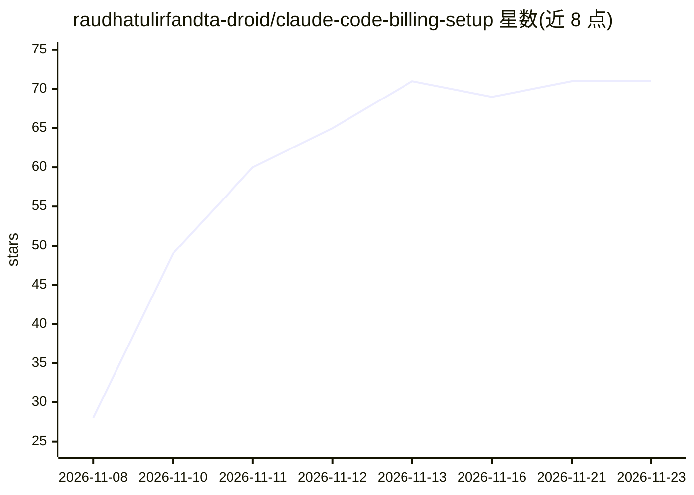

# raudhatulirfandta-droid/claude-code-billing-setup

⭐ 71 · 推送 2026-11-03 · [GitHub](https://github.com/raudhatulirfandta-droid/claude-code-billing-setup) · [官网](https://app.coregold.io/signup?invite_code=ADvlj9b) · 个人维护 · 中文 README

**教程/推广：用 CoreGold 虚拟商业卡为 Claude Code 与 Anthropic 绑卡**

内容为一篇绑卡操作指南并推广 CoreGold 虚拟卡服务：面向使用 Claude Code 终端与 Claude 3.7 Sonnet 的用户，说明官方收单对预付卡的拦截机制，并给出通过 CoreGold 控制台充值 USDT、生成北美商业 BIN 卡号与配套 AVS 地址、再在 Claude 官网或 Anthropic Console 绑卡的步骤。README 末尾附有控制台入口标识。仓库不含代码、库或可安装产品，仅为此说明文档。

## 筛选速览

| 维度 | 判定 | 备注 |
|---|---|---|
| AI 角色 | `ai-knowledge` | 知识聚合/清单类 |
| 许可风险 | `none` | — |
| 部署形态 | `None` |  |
| 模型依赖 | — | README 未给出锁定关系 |
| 硬件要求 | — | 无带数字的原话,不猜 |
| 安装摩擦 | `low` | 无编译、无系统依赖或容器化 |
| 成熟度 | — | 结构信号不足 |

## 能力要点

- 说明 Stripe/AVS 核验导致预付卡被拦截的机制
- 给出 3 步绑卡流程（USDT 充值→生成卡号→绑卡扣费）
- 标注 CoreGold Pro 套餐价格 $20/月，单卡限额示例 $25

## 适用场景

- 了解为 Claude Code 订阅绑卡被拒的一种应对路径
- 按步骤开通 CoreGold 虚拟卡并完成 Anthropic 绑卡

## 场景标签

 · 领域:AI 服务支付/教程

## 证据(README 行号)

> L2: Claude 3.7 混合思考与 Claude Code 终端免拒绑卡：用 CoreGold 商业卡破除 Anthropic 幽灵退款砍单。
> L16: ### 二、3 分钟打通订阅流水线
> L18: 1. **注入底池**：进入 CoreGold 控制台，使用 USDT（TRC20/ERC20）充值（建议充 25 USDT 预留验资缓冲），秒级转为 USD 余额。

## 星数曲线

2026-11-08 28 → 2026-11-23 71（+43）

---
*卡片 v1 · prompt 1.4 · 生成 2026-11-18 · 置信度 high · 依据 README sha `3f27a3848a5a` · [字段定义](../../DATASET.md)*
