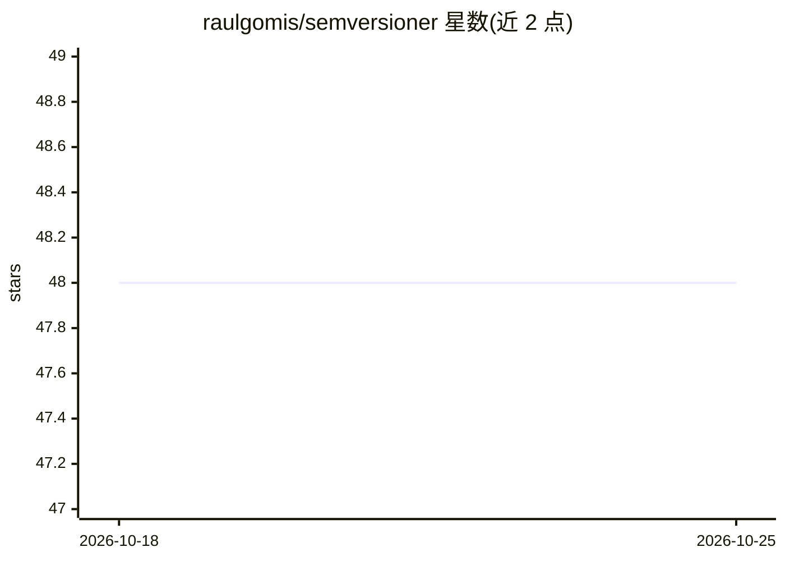

# raulgomis/semversioner

⭐ 48 · Python · MIT · 推送 2026-07-18 · [GitHub](https://github.com/raulgomis/semversioner) · 个人维护

**面向 AI 原生项目的语义化版本与 CHANGELOG 自动化 CLI**

用 pip 安装的 Python 命令行工具，供开发者和 AI 编码代理管理语义化版本：通过 add-change 生成 JSON changeset 文件随代码提交，release 命令按 major/minor/patch 规则计算下一版本号并聚合为版本 JSON，changelog 命令生成 CHANGELOG.md，模板基于 Jinja2 可自定义并支持自定义属性过滤。面向库、Docker 镜像、微服务等发布流程设计，CI/CD 中可用 check 命令强制 PR 携带 changeset。项目灵感来自 AWS 管理 AWS-cli 版本的方式。

## 筛选速览

| 维度 | 判定 | 备注 |
|---|---|---|
| AI 角色 | `ai-ecosystem` | LLM/agent 周边工具 |
| 许可风险 | `permissive` | MIT |
| 部署形态 | `library` | 以包/库形式分发 |
| 模型依赖 | — | README 未给出锁定关系 |
| 硬件要求 | — | 无带数字的原话,不猜 |
| 安装摩擦 | `low` | 无编译、无系统依赖或容器化 |
| 成熟度 | — | 结构信号不足 |

## 能力要点

- changeset 以独立 JSON 文件随提交保留，发布意图可审查（人或 AI 代理编写均可）
- release 自动计算 major/minor/patch 版本号并聚合生成版本 JSON
- Jinja2 自定义 CHANGELOG 模板，支持自定义属性与按版本过滤
- check 命令在 CI/CD 中强制 PR 包含 changeset

## 适用场景

- 在 CI/CD 流水线中自动计算版本号并生成 CHANGELOG.md
- AI 编码代理提交代码时同步记录变更意图
- 用 check 命令拦截缺少变更说明的 PR

## 场景标签

 · 领域:开发工具/发布自动化

## 证据(README 行号)

> L3: **Release automation for AI-native software delivery.**
> L5: Semversioner makes it easy for developers and AI coding agents to manage

## 星数曲线

2026-10-18 48 → 2026-10-25 48（+0）

---
*卡片 v1 · prompt 1.4 · 生成 2026-10-25 · 置信度 mid · 依据 README sha `36998045d790` · [字段定义](../../DATASET.md)*
