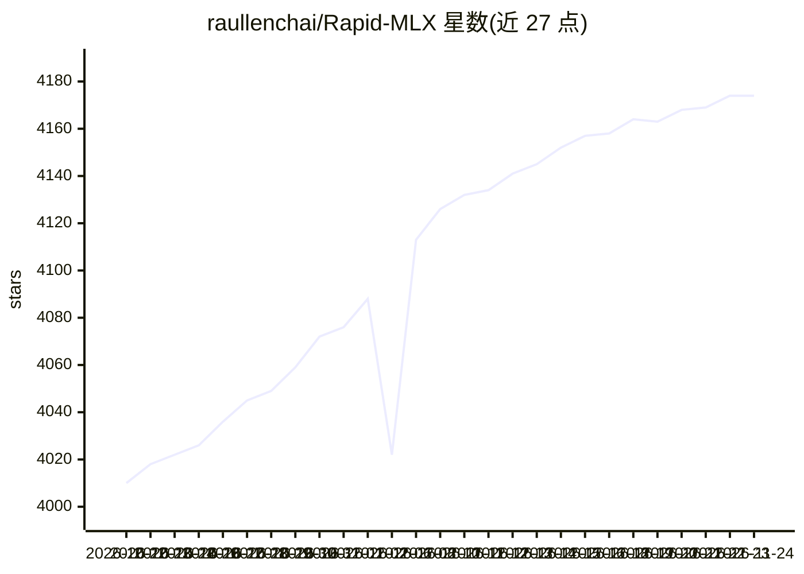

# raullenchai/Rapid-MLX

⭐ 4,174 · Python · Apache-2.0 · 推送 2026-11-22 · [GitHub](https://github.com/raullenchai/Rapid-MLX) · [官网](https://rapidmlx.com) · 个人维护

**面向 Apple Silicon 的本地 LLM 推理服务器，为编码 agent 提供本地后端**

基于 MLX 构建的 Apache-2.0 推理服务器，暴露 OpenAI（/v1/chat/completions、/v1/responses）与 Anthropic Messages（/v1/messages）本地端点，聚焦编码 agent 所需的工具调用解析（27 个 parser 模块与自动检测回退）。支持 continuous batching、radix 前缀缓存与量化 KV cache，提供 macOS Desktop 应用管理模型、对话与基准测试。提供 curl 引导安装器、Homebrew 与 pip 三种安装途径；README 附与 oMLX、Ollama、LM Studio、mlx-lm 的功能与速度对照表。

## 筛选速览

| 维度 | 判定 | 备注 |
|---|---|---|
| AI 角色 | `ai-ecosystem` | LLM/agent 周边工具 |
| 许可风险 | `permissive` | Apache-2.0 |
| 部署形态 | `library` | 以包/库形式分发 |
| 模型依赖 | — | README 未给出锁定关系 |
| 硬件要求 | — | 无带数字的原话,不猜 |
| 安装摩擦 | `medium` | 含编译或系统依赖之一 |
| 成熟度 | — | 结构信号不足 |

## 能力要点

- OpenAI 与 Anthropic Messages 双兼容本地 API 端点
- 27 个工具调用 parser 模块，含自动检测回退
- continuous batching 与 radix 前缀缓存（关机落盘、启动恢复）
- rapid-mlx launch <agent> 一条命令启动 Codex/Claude Code 等编码 agent

## 适用场景

- 在 Mac 上为 Claude Code、Codex 等编码 agent 接入本地模型
- 用 OpenAI 或 Anthropic SDK 指向 localhost 端点调用本地模型
- 本地托管模型并运行社区基准对比不同模型的解码速度

## 场景标签

`推理引擎` · 领域:训练与推理

## 证据(README 行号)

> L30:  Rapid-MLX is an open-source (Apache 2.0) OpenAI- and Anthropic-compatible LLM inference server for Apple Silicon, 
> L127: Use Rapid-MLX as a local backend for agents, apps, or your own code. If a
> L163: - Requires an M-series Mac; Windows and Linux desktop builds are not available yet

## 星数曲线

2026-10-22 4,010 → 2026-11-24 4,174（+164）

---
*卡片 v1 · prompt 1.4 · 生成 2026-11-23 · 置信度 high · 依据 README sha `fb68f2707491` · [字段定义](../../DATASET.md)*
