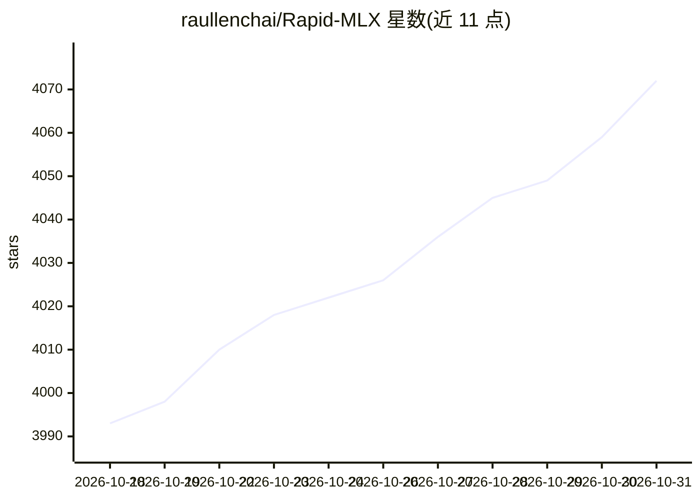

# raullenchai/Rapid-MLX

⭐ 4,072 · Python · NOASSERTION · 推送 2026-10-30 · [GitHub](https://github.com/raullenchai/Rapid-MLX) · [官网](https://rapidmlx.com) · 个人维护

**Apple Silicon 本地 LLM 推理服务器，OpenAI/Anthropic 兼容**

基于 MLX 的开源（Apache 2.0）本地推理服务器，面向 Apple Silicon Mac，提供 OpenAI（/v1/chat/completions、/v1/responses）与 Anthropic Messages（/v1/messages）兼容 API，主打面向编码 agent 的工具调用，含 27 个工具调用解析器模块与自动检测回退。支持连续批处理、Radix 前缀缓存（可持久化到磁盘并重启恢复）与量化 KV 缓存。通过 Homebrew、PyPI、引导脚本安装，另有 macOS Desktop 应用；内置视觉、图像与视频生成运行时，音频与嵌入为可选 extras。README 给出与 mlx-lm、oMLX、LM Studio 的实测速度对比数据。

## 筛选速览

| 维度 | 判定 | 备注 |
|---|---|---|
| AI 角色 | `ai-ecosystem` | LLM/agent 周边工具 |
| 许可风险 | `none` | NOASSERTION |
| 部署形态 | `library` | 以包/库形式分发 |
| 模型依赖 | locked-api |  |
| 硬件要求 | — | 无带数字的原话,不猜 |
| 安装摩擦 | `medium` | 含编译或系统依赖之一 |
| 成熟度 | — | 结构信号不足 |

## 能力要点

- OpenAI 与 Anthropic Messages 双兼容 API，可被本地端点客户端直接使用
- 27 个工具调用解析模块，含自动检测回退
- 连续批处理、Radix 前缀缓存（关机存盘、启动恢复）、量化 KV 缓存
- 一条命令为 Claude Code 等 IDE 客户端写入本地端点配置

## 适用场景

- 在 Mac 上本地跑 LLM 作为 Claude Code、Aider 等编码 agent 的后端
- 为支持 OpenAI/Anthropic 兼容端点的应用提供本地推理服务
- 本地图像生成与图片编辑（flux2-klein、qwen-image 等）

## 场景标签

`推理引擎` `图像生成` `视频生成` · 领域:内容生成

## 证据(README 行号)

> L5:  Rapid-MLX is an open-source (Apache 2.0) OpenAI- and Anthropic-compatible LLM inference server for Apple Silicon, b
> L56: |**Local API**|OpenAI (`/v1/chat/completions`, `/v1/responses`) and Anthropic Messages (`/v1/messages`)|OpenAI and 
> L73: Use Rapid-MLX as a local backend for agents, apps, or your own code. If a

## 星数曲线

2026-10-18 3,993 → 2026-10-31 4,072（+79）

---
*卡片 v1 · prompt 1.4 · 生成 2026-10-20 · 置信度 high · 依据 README sha `e814e8e4d281` · [字段定义](../../DATASET.md)*
