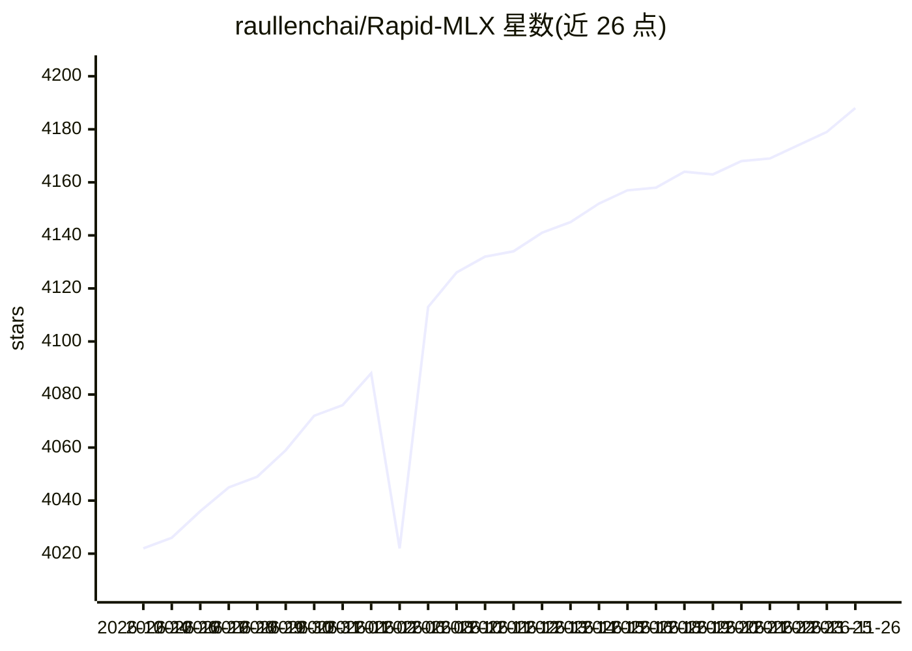

# raullenchai/Rapid-MLX

⭐ 4,188 · Python · Apache-2.0 · 推送 2026-11-25 · [GitHub](https://github.com/raullenchai/Rapid-MLX) · [官网](https://rapidmlx.com) · 个人维护

**给 Mac 上编程 Agent 用的本地 LLM 推理服务器**

基于 MLX 的 Apple Silicon 本地推理服务器，提供 OpenAI 与 Anthropic 兼容端点（/v1/chat/completions、/v1/responses、/v1/messages），面向在本地模型上运行 Codex、Claude Code、OpenCode 等编程 Agent 的开发者。核心机制包括持续批处理、radix 前缀缓存、27 个工具调用解析模块，并以 `rapid-mlx launch <agent>` 一条命令创建私有配置并启动 Agent。限制：仅支持 Apple Silicon Mac，Windows/Linux 桌面版尚未提供；README 声称对比 mlx-lm 解码最快 4 倍并附实测表格。

## 筛选速览

| 维度 | 判定 | 备注 |
|---|---|---|
| AI 角色 | `ai-ecosystem` | LLM/agent 周边工具 |
| 许可风险 | `permissive` | Apache-2.0 |
| 部署形态 | `library` | 以包/库形式分发 |
| 模型依赖 | locked-api |  |
| 硬件要求 | — | 无带数字的原话,不猜 |
| 安装摩擦 | `medium` | 含编译或系统依赖之一 |
| 成熟度 | — | 结构信号不足 |

## 能力要点

- OpenAI 与 Anthropic 兼容的本地 API 端点
- 持续批处理与 radix 前缀缓存（含关机存盘、启动恢复）
- 27 个工具调用解析模块，含自动检测回退
- 一条命令为多种编程 Agent 创建私有配置并启动

## 适用场景

- 在 Mac 上用本地模型运行 Claude Code/Codex 等编程 Agent
- 给 LangChain、PydanticAI 等客户端提供本地 OpenAI 兼容端点
- 管理和聊天本地模型、运行社区基准测试

## 场景标签

`推理引擎` · 领域:训练与推理

## 证据(README 行号)

> L30:  Rapid-MLX is an open-source (Apache 2.0) OpenAI- and Anthropic-compatible LLM inference server for Apple Silicon, 
> L127: Use Rapid-MLX as a local backend for agents, apps, or your own code. If a

## 星数曲线

2026-10-24 4,022 → 2026-11-26 4,188（+166）

---
*卡片 v1 · prompt 1.4 · 生成 2026-11-26 · 置信度 high · 依据 README sha `aa38be411f49` · [字段定义](../../DATASET.md)*
