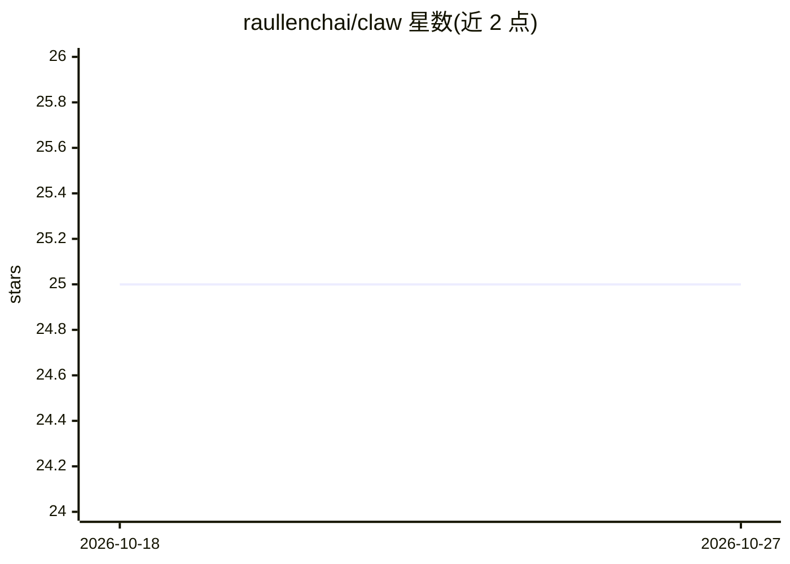

# raullenchai/claw

⭐ 25 · Python · MIT · 推送 2026-01-18 · [GitHub](https://github.com/raullenchai/claw) · 个人维护

**通过浏览器远程监控与操控 Claude Code 会话的工具**

用 Python 标准库实现的 Web 服务：读取本机 tmux 会话/窗口/面板内容，在手机等浏览器中实时查看 Claude Code 终端，发送 yes/no/continue 等快捷指令与 Ctrl+C 控制键，切换会话，并展示 git 状态、CPU/内存等系统信息。提供同 WiFi 绑定、--share 隧道（自动下载 cloudflared、密码保护）、Cloudflare 固定域名与 Tailscale 四种访问方式。依赖 Python 3.8+ 与 tmux，Windows 需经 WSL 使用 tmux。

## 筛选速览

| 维度 | 判定 | 备注 |
|---|---|---|
| AI 角色 | `ai-ecosystem` | LLM/agent 周边工具 |
| 许可风险 | `permissive` | MIT |
| 部署形态 | `library` | 以包/库形式分发 |
| 模型依赖 | — | README 未给出锁定关系 |
| 硬件要求 | — | 无带数字的原话,不猜 |
| 安装摩擦 | `low` | 无编译、无系统依赖或容器化 |
| 成熟度 | — | 结构信号不足 |

## 能力要点

- 手机浏览器实时查看与操控 tmux 中的 Claude Code 会话
- 一键发送 yes/no/continue//compact/Ctrl+C 快捷操作
- --share 自动建立 Cloudflare 隧道（密码保护、HTTPS）
- 仅依赖 Python 3.8+ 标准库与 tmux，无需额外 pip 依赖

## 适用场景

- 离开桌面时用手机查看并回应 Claude Code 的长会话
- 在外网通过隧道远程接管家中的开发终端
- 同时监控多个 tmux 会话、git 状态与系统资源

## 场景标签

 · 领域:开发者工具/终端远程管理

## 证据(README 行号)

> L19: Running a long Claude Code session? Need to step away from your desk? **Claw** lets you monitor and control Claude 
> L85: Claw - Remote control for Claude Code sessions
> L209: |`/api/send`|`{"session": "name", "window": "1", "pane": "0", "text": "yes", "enter": true}`|Send text to pane|

## 星数曲线

2026-10-18 25 → 2026-10-27 25（+0）

---
*卡片 v1 · prompt 1.4 · 生成 2026-10-26 · 置信度 high · 依据 README sha `a46576591300` · [字段定义](../../DATASET.md)*
