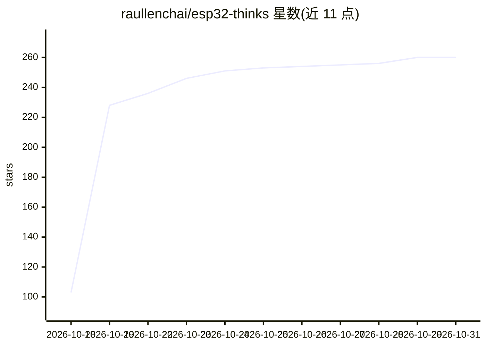

# raullenchai/esp32-thinks

⭐ 260 · Shell · MIT · 推送 2026-10-19 · [GitHub](https://github.com/raullenchai/esp32-thinks) · 个人维护

**ESP32 个人 AI 语音助手固件：可自选任意 OpenAI 兼容模型**

基于 Meta 开源 muse-gadget-sdk（固定 commit + patch）构建的 ESP32-S3 语音助手固件：片上唤醒词（esp-sr WakeNet10 "Hi, ESP"）或按键启动对话，STT/聊天/TTS 三个端点相互独立，可各自指向任意 OpenAI 兼容服务器并自由混搭。支持逐句流式合成、打断（barge-in）、静音防护与停滞自动恢复。可选仓库内 openmuse 代理层（Docker 或 Node），提供位置/天气/时钟/记忆工具。面向会烧录固件的开发者/创客，需 ESP-IDF v6.0.x 编译烧录，目标硬件为 Seeed SenseCAP Watcher W1-B。

## 筛选速览

| 维度 | 判定 | 备注 |
|---|---|---|
| AI 角色 | `ai-native` | 本体是模型或模型工具 |
| 许可风险 | `permissive` | MIT |
| 部署形态 | `None` |  |
| 模型依赖 | — | README 未给出锁定关系 |
| 硬件要求 | — | 无带数字的原话,不猜 |
| 安装摩擦 | `low` | 无编译、无系统依赖或容器化 |
| 成熟度 | — | 结构信号不足 |

## 能力要点

- STT/chat/TTS 三端点独立配置，任意 OpenAI 兼容服务器可混搭
- 流式回复：按句解析边生成边合成，支持打断
- 片上 WakeNet10 唤醒词，无厂商账号、无 App 配网
- 可选 openmuse 本地代理层：位置/天气/记忆工具，Tailscale 暴露 HTTPS

## 适用场景

- 在 ESP32-S3 小设备上搭建不绑定单一厂商的个人语音助手
- 为转录、聊天、语音分别选用不同模型服务商以控制成本
- 通过 openmuse 代理给设备加上位置、天气与跨轮记忆能力

## 场景标签

`语音 Agent` · 领域:对话与助手

## 证据(README 行号)

> L13: Think of it as a Muse that thinks with **your** models: say **"Hi, ESP"** (or press the knob), ask anything, and it
> L29: - **Bring your own brain** — three independent OpenAI-compatible endpoints (STT / chat / TTS) in one config file. M
> L121: |Brain|Any OpenAI-compatible servers: STT (`/audio/transcriptions`), chat (`/chat/completions`, SSE streaming), sp

## 星数曲线

2026-10-18 103 → 2026-10-31 260（+157）

---
*卡片 v1 · prompt 1.4 · 生成 2026-10-22 · 置信度 high · 依据 README sha `4e2ad7df8b08` · [字段定义](../../DATASET.md)*
