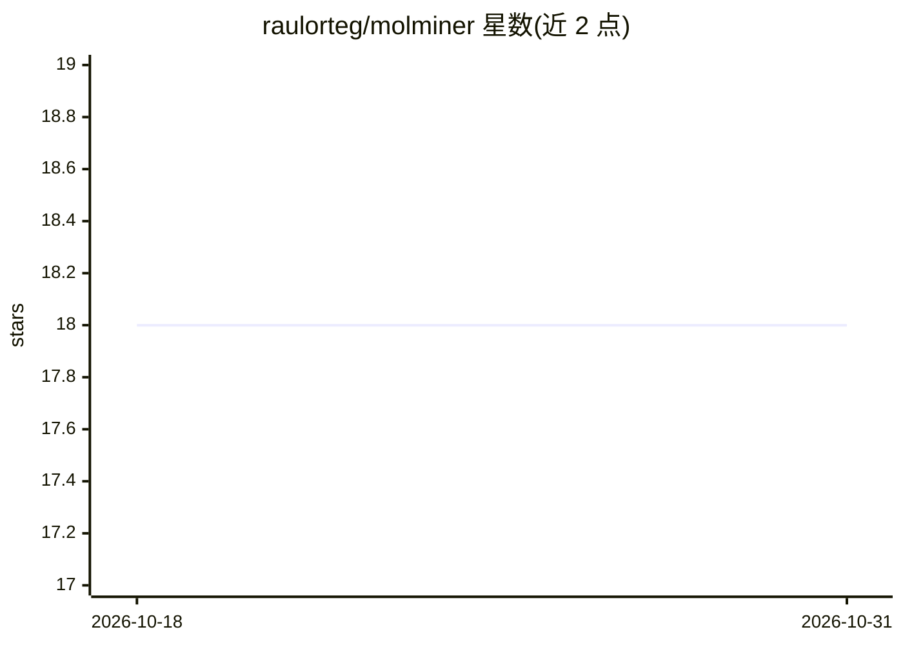

# raulorteg/molminer

⭐ 18 · Python · Apache-2.0 · 推送 2026-07-28 · [GitHub](https://github.com/raulorteg/molminer) · 个人维护

**片段式 3D 感知的条件分子设计生成模型**

面向分子设计研究者与药物/材料领域开发者的生成式 Transformer：逐片段构建分子，过程中保持 3D 几何感知，支持顺序无关 roll-out 与对称性感知的连接处理，最多同时施加 12 个性质条件（logP、QED、molWt 等）。提供词表抽取、预处理、GMM、Fragment-Starter 与完整训练的端到端 Python 脚本；预训练权重托管于 Zenodo，可通过不等式约束窗口做条件生成并输出命中子集，支持 CPU 设备运行。

## 筛选速览

| 维度 | 判定 | 备注 |
|---|---|---|
| AI 角色 | `ai-native` | 本体是模型或模型工具 |
| 许可风险 | `permissive` | Apache-2.0 |
| 部署形态 | `library` | 以包/库形式分发 |
| 模型依赖 | — | README 未给出锁定关系 |
| 硬件要求 | — | 无带数字的原话,不猜 |
| 安装摩擦 | `low` | 无编译、无系统依赖或容器化 |
| 成熟度 | — | 结构信号不足 |

## 能力要点

- 逐片段、3D 几何感知的分子生成
- 最多 12 个同时性质条件，支持不等式约束窗口生成
- 从词表抽取到完整训练的端到端脚本
- 预训练检查点（MolMiner/GMM/Fragment-Starter）托管于 Zenodo

## 适用场景

- 按 logP、分子量等性质窗口约束生成候选分子
- 在自己的分子数据集上重训 MolMiner 模型
- 对生成分子做性质统计与校准分析

## 场景标签

`模型训练` · 领域:训练与推理

## 证据(README 行号)

> L9: MolMiner is a **multi-property-conditioned, geometry-aware transformer** that builds molecules *fragment-by-fragment
> L13: * Up to **12 simultaneous property conditions** (logP, QED, …)

## 星数曲线

2026-10-18 18 → 2026-10-31 18（+0）

---
*卡片 v1 · prompt 1.4 · 生成 2026-10-29 · 置信度 mid · 依据 README sha `c255ba0261cc` · [字段定义](../../DATASET.md)*
