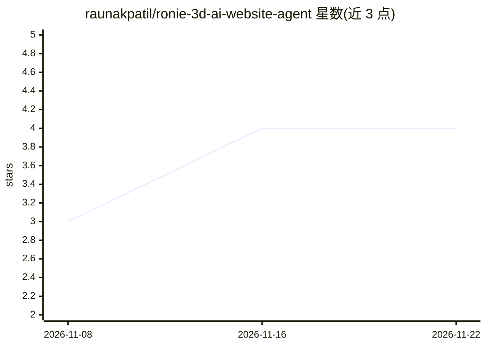

# raunakpatil/ronie-3d-ai-website-agent

⭐ 4 · JavaScript · NOASSERTION · 推送 2026-11-01 · [GitHub](https://github.com/raunakpatil/ronie-3d-ai-website-agent) · [官网](https://raunakpatil.com/ronie) · 个人维护

**为网站提供 3D AI 导航角色的开源模板**

一个可嵌入任意网站的 3D 虚拟角色模板：访客到达后角色醒来，通过语音与文字回答问题，回答仅基于由站点内容脚本生成的 facts 文件以防编造；每次回复携带面部、图标与动作标签驱动 3D 表现。语音由 Kokoro-82M 在访客浏览器 GPU 上运行，模型链在免费额度间自动切换。提供去除个人信息的 template/ 目录，无构建步骤，worker 部署到 Cloudflare 后提供后端。

## 筛选速览

| 维度 | 判定 | 备注 |
|---|---|---|
| AI 角色 | `ai-native` | 本体是模型或模型工具 |
| 许可风险 | `none` | NOASSERTION |
| 部署形态 | `None` |  |
| 模型依赖 | — | README 未给出锁定关系 |
| 硬件要求 | — | 无带数字的原话,不猜 |
| 安装摩擦 | `low` | 无编译、无系统依赖或容器化 |
| 成熟度 | — | 结构信号不足 |

## 能力要点

- 回答仅来自 facts 文件，含 prompt-injection 防御与每访客流控
- 23 种面部表情与 23 个 Blender 代码生成的动作，回复标签驱动
- Kokoro-82M 神经语音在访客浏览器 WebGPU 上运行，无服务器成本
- 支持任意 rigged glTF/GLB 角色与自定义 persona/世界

## 适用场景

- 给个人作品集网站加一个能回答招聘者提问的 3D 向导
- 为商店/SaaS 站点提供语音问答与产品推荐角色
- 给课程或博物馆站点做只基于资料回答的讲解角色

## 场景标签

`聊天机器人` `语音合成` · 领域:对话与助手

## 证据(README 行号)

> L33: He's a 3D character who lives on a web page. A visitor can ask *"What do you offer?"*, *"Is she available?"* or *"W
> L38: He's also a **complete tech demo** of an AI product built end to end: LLM orchestration with grounding and
> L105: ## One agent, any website

## 星数曲线

2026-11-08 3 → 2026-11-22 4（+1）

---
*卡片 v1 · prompt 1.4 · 生成 2026-11-21 · 置信度 high · 依据 README sha `0c1dc030871d` · [字段定义](../../DATASET.md)*
