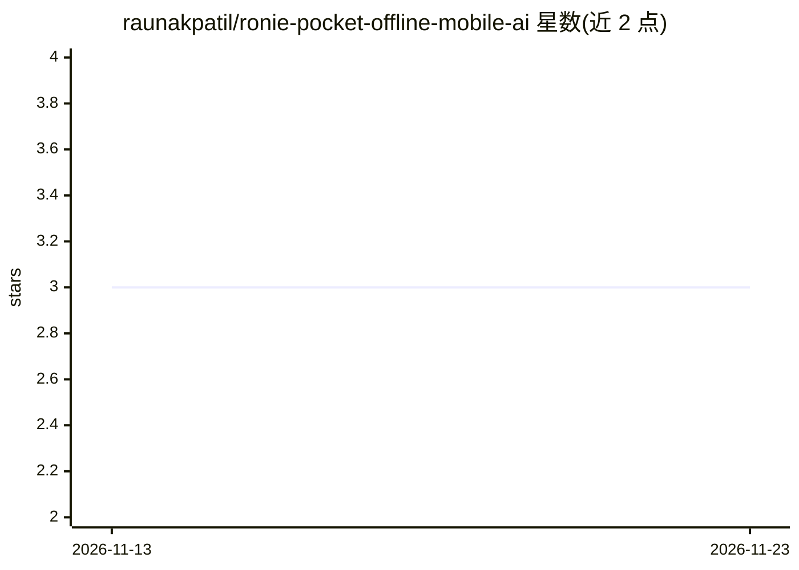

# raunakpatil/ronie-pocket-offline-mobile-ai

⭐ 3 · Kotlin · Apache-2.0 · 推送 2026-11-13 · [GitHub](https://github.com/raunakpatil/ronie-pocket-offline-mobile-ai) · 个人维护

**手机端 100% 离线运行的无审查 AI 助手与图像生成应用**

Android 应用，将 Gemma 4 等本地大模型与 SD-Turbo 图像生成模型跑在手机 GPU 上（基于 llama.cpp Vulkan 后端），聊天、语音输入与朗读、图像生成、记忆、提醒任务、MCP 工具连接均在本机完成，无需账号与 API key。按手机内存自动选择模型（4GB 选 Qwen3.5-0.8B，12GB+ 选 Gemma 4）。提供 release 下载；源码构建需 Android Studio、NDK 与 Windows .cmd 脚本。图像生成模型许可限非商业用途。

## 筛选速览

| 维度 | 判定 | 备注 |
|---|---|---|
| AI 角色 | `ai-native` | 本体是模型或模型工具 |
| 许可风险 | `permissive` | Apache-2.0 |
| 部署形态 | `None` |  |
| 模型依赖 | local-ok | 支持本地模型 |
| 硬件要求 | — | 无带数字的原话,不猜 |
| 安装摩擦 | `low` | 无编译、无系统依赖或容器化 |
| 成熟度 | — | 结构信号不足 |

## 能力要点

- 聊天与图像生成全程本机运行，支持飞行模式
- 按内存自动选配三档模型（Gemma 4 / Qwen3.5-2B / 0.8B）
- 端上语音输入与 TTS 朗读、加密记忆、MCP 服务器连接
- 可选用 DuckDuckGo 网页搜索并去除个人敏感信息

## 适用场景

- 在无网络环境下使用 AI 聊天、画图和任务提醒
- 不想注册账号或数据上传云端时使用手机 AI 助手
- 在聊天中生成无过滤的图像并保存分享

## 场景标签

`AI 助手` `图像生成` · 领域:对话与助手

## 证据(README 行号)

> L3: # Ronie Pocket: uncensored AI assistant and image generator that runs 100% on your phone
> L50: - 🧠 **A real brain on your phone.** Google's **Gemma 4** runs on your phone's GPU. Ronie is ready about **5 seconds
> L136: The app is Kotlin + Jetpack Compose on top of a llama.cpp engine with a Vulkan GPU backend. The build scripts are 

## 星数曲线

2026-11-13 3 → 2026-11-23 3（+0）

---
*卡片 v1 · prompt 1.4 · 生成 2026-11-21 · 置信度 high · 依据 README sha `c3507478c416` · [字段定义](../../DATASET.md)*
