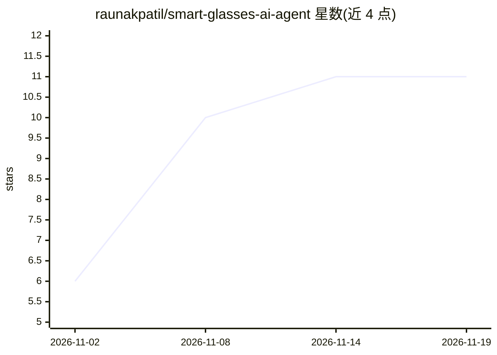

# raunakpatil/smart-glasses-ai-agent

⭐ 11 · Python · MIT · 推送 2026-11-08 · [GitHub](https://github.com/raunakpatil/smart-glasses-ai-agent) · [官网](https://raunakpatil.com/) · 个人维护

**Ray-Ban Meta 眼镜的开源语音 AI agent，控制电视与笔记本**

面向 Ray-Ban Meta 眼镜的开源免提 AI agent：眼镜经蓝牙连到 Android 应用，应用唤醒词监听并将语音流至 Gemini Live，需要深度思考时由 FastAPI 自建"大脑"服务器的模型路由转发到 Claude/ChatGPT/DeepSeek/Groq/OpenRouter 或本地 Ollama。大脑承载工具（网页搜索、视觉、国际象棋、记忆、投屏）、可查看编辑的长期记忆，并能通过手机控制 Android/Google TV、经 Windows 笔记本代理打开页面与视频。需自备 API key 与服务器，无订阅。

## 筛选速览

| 维度 | 判定 | 备注 |
|---|---|---|
| AI 角色 | `ai-native` | 本体是模型或模型工具 |
| 许可风险 | `permissive` | MIT |
| 部署形态 | `None` |  |
| 模型依赖 | local-ok | 支持本地模型 |
| 硬件要求 | — | 无带数字的原话,不猜 |
| 安装摩擦 | `low` | 无编译、无系统依赖或容器化 |
| 成熟度 | — | 结构信号不足 |

## 能力要点

- 模型路由支持 Gemini/Claude/ChatGPT/DeepSeek/Groq/OpenRouter 与本地 Ollama
- 长期记忆可在应用中查看、编辑、删除，跨模型共享
- 语音控制 Android/Google TV 与 Windows 笔记本（开应用、投屏、控制音量）
- 唤醒词在手机端本地运行，记忆与密钥存于自建服务器

## 适用场景

- 戴着眼镜边看边问，让答案在耳机播报并同步投屏到电视或笔记本
- 用语音控制电视、应用和 PS5 等 HDMI 设备
- 真实面试中通过笔记本听取提问并获得要点提示
- 让助手记住停车位置、日程与人名偏好并随时询问

## 场景标签

`语音 Agent` `AI 助手` `模型网关` `Agent 记忆` · 领域:Agent 开发

## 证据(README 行号)

> L14:  Ronie Go is an open-source, hands-free AI agent for Ray-Ban Meta glasses. Say "Ronie" and just talk. It sees what 
> L93: **3 · The AI model.** Your voice goes to Gemini Live, which listens, speaks back and can be interrupted mid-sentenc
> L95: **4 · The brain.** A small Python server (FastAPI) that you run. It holds the instructions, the tools (web search, 

## 星数曲线

2026-11-02 6 → 2026-11-19 11（+5）

---
*卡片 v1 · prompt 1.4 · 生成 2026-11-18 · 置信度 high · 依据 README sha `fcccd4570fdc` · [字段定义](../../DATASET.md)*
