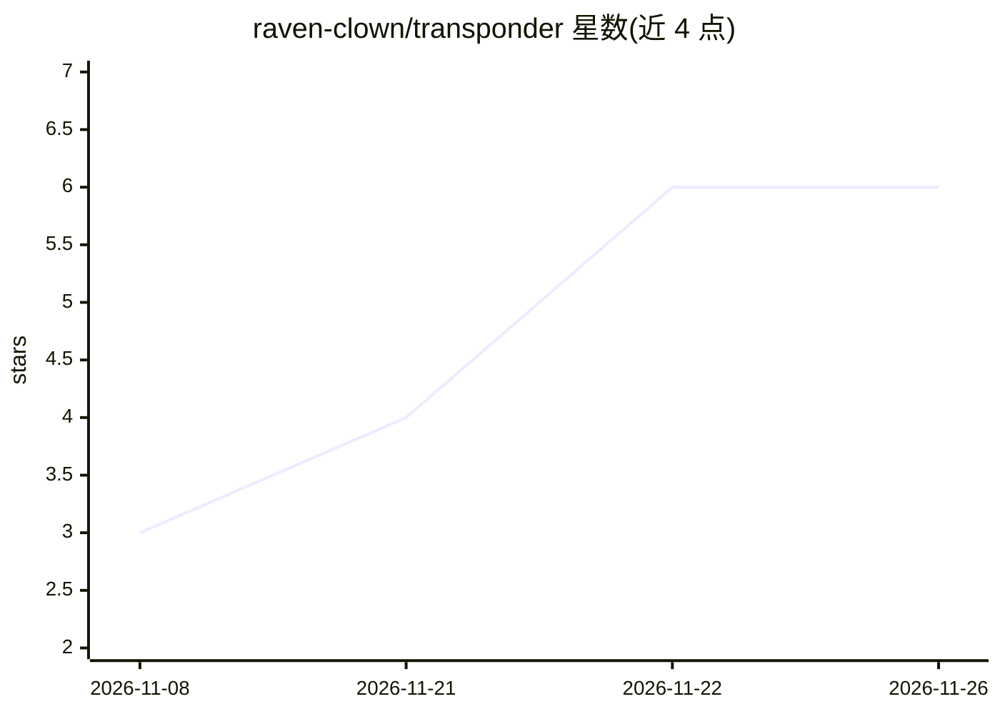

# raven-clown/transponder

⭐ 6 · Go · Apache-2.0 · 推送 2026-11-25 · [GitHub](https://github.com/raven-clown/transponder) · 个人维护

**团队的 LLM 网关：统一 API 接入多家模型并管用量预算**

用 Go 编写的 LLM 网关，以一个二进制程序置于 OpenAI、Anthropic、Gemini、Ollama 等 18 类提供方之前，讲 OpenAI 与 Anthropic 两种 API 方言并在失败时按序回退。内置 OIDC 登录与角色、按用户/团队/密钥的用量与成本统计、跨副本生效的预算限制，提供 JSON 管理端 API、Prometheus 指标与 OTLP 追踪。默认 SQLite，可选 Postgres 支持多副本；全部功能在 Apache-2.0 下免费。面向需要共享网关并追踪开支的团队。

## 筛选速览

| 维度 | 判定 | 备注 |
|---|---|---|
| AI 角色 | `ai-ecosystem` | LLM/agent 周边工具 |
| 许可风险 | `permissive` | Apache-2.0 |
| 部署形态 | `desktop` | 安装包/桌面程序 |
| 模型依赖 | local-ok | 支持本地模型 |
| 硬件要求 | — | 无带数字的原话,不猜 |
| 安装摩擦 | `low` | 无编译、无系统依赖或容器化 |
| 成熟度 | — | 结构信号不足 |

## 能力要点

- 18 类提供方适配，OpenAI/Anthropic 方言互译，按序回退与冷却降权
- OIDC 登录、角色与按路由的访问控制
- 按用户/团队/密钥的每日与每月美元预算，跨副本生效
- Prometheus 指标、OTLP 追踪与 JSON 管理 API（OpenAPI 描述）

## 适用场景

- 为团队提供统一 API 入口，按用户和密钥追踪 token 与成本
- 多家模型提供方之间配置故障回退
- 用自有 OIDC 身份源为 API 调用做鉴权与预算控制
- 用 docker compose 起一个无密钥演示环境看请求流与面板

## 场景标签

`模型网关` · 领域:Agent 开发

## 证据(README 行号)

> L12: **An LLM gateway that knows who is spending what.** One Go binary in front of OpenAI, Anthropic, Gemini, Ollama and
> L117: - 18 provider types, plus any OpenAI-compatible server. Providers
> L145: ## Providers

## 星数曲线

2026-11-08 3 → 2026-11-26 6（+3）

---
*卡片 v1 · prompt 1.4 · 生成 2026-11-21 · 置信度 high · 依据 README sha `b620db7a8edb` · [字段定义](../../DATASET.md)*
