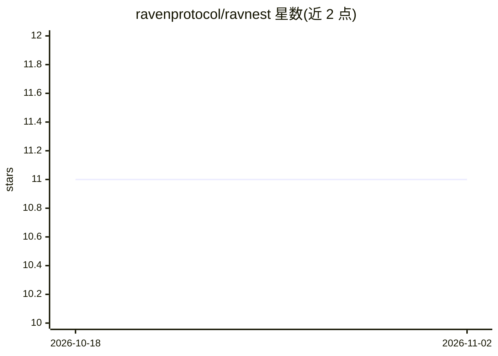

# ravenprotocol/ravnest

⭐ 11 · Python · MIT · 推送 2026-10-19 · [GitHub](https://github.com/ravenprotocol/ravnest) · 组织维护

**面向研究者的去中心化异步分布式深度学习训练框架**

提供结合数据并行与模型并行的异步并行训练方法，支持在互联网连接的异构消费级 PC 集群上训练复杂深度学习模型。面向研究人员与机器学习从业者，通过 pip 安装或克隆源码使用，流程为运行 cluster_formation.py 生成分片模型文件，再在多个终端分别以不同节点名启动 provider 脚本。示例覆盖 CNN、ResNet-50、Inception-V3、GPT-Sorter、BERT 等模型，配有 arXiv 论文与 readthedocs 文档。

## 筛选速览

| 维度 | 判定 | 备注 |
|---|---|---|
| AI 角色 | `ai-ecosystem` | LLM/agent 周边工具 |
| 许可风险 | `permissive` | MIT |
| 部署形态 | `library` | 以包/库形式分发 |
| 模型依赖 | — | README 未给出锁定关系 |
| 硬件要求 | — | 无带数字的原话,不猜 |
| 安装摩擦 | `low` | 无编译、无系统依赖或容器化 |
| 成熟度 | — | 结构信号不足 |

## 能力要点

- 异步并行训练结合数据并行与模型并行
- 支持通过互联网连接的异构消费级 PC 集群
- 示例支持 CNN/ResNet-50/Inception-V3/GPT-Sorter/BERT 模型
- 提供 arXiv 研究论文与 readthedocs 文档

## 适用场景

- 在没有专用集群的普通 PC 上做分布式深度学习训练
- 研究者复现论文中的异步训练实验
- 多节点多终端模拟去中心化训练环境

## 场景标签

`模型训练` · 领域:训练与推理

## 证据(README 行号)

> L6: Ravnest introduces a novel asynchronous parallel training approach that combines the best aspects of data and model 
> L10: **Research Paper**: https://arxiv.org/abs/2401.01728

## 星数曲线

2026-10-18 11 → 2026-11-02 11（+0）

---
*卡片 v1 · prompt 1.4 · 生成 2026-11-01 · 置信度 high · 依据 README sha `b49548d2a8bf` · [字段定义](../../DATASET.md)*
