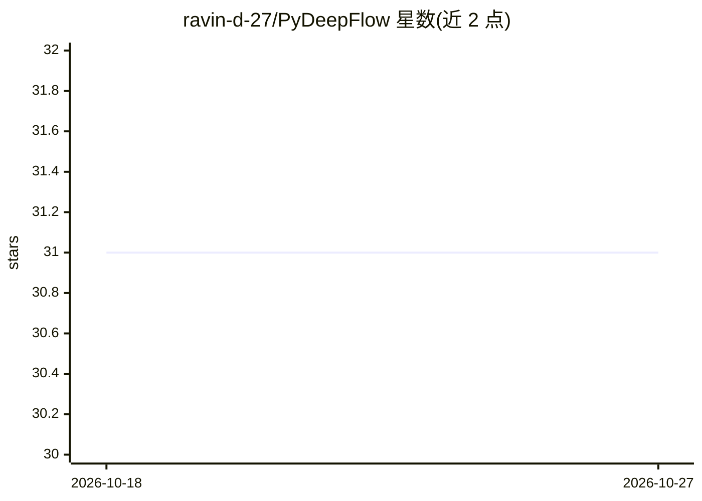

# ravin-d-27/PyDeepFlow

⭐ 31 · Python · MIT · 推送 2025-11-02 · [GitHub](https://github.com/ravin-d-27/PyDeepFlow) · [官网](https://pypi.org/project/pydeepflow/) · 个人维护

**面向初学者的 Python 深度学习库：构建与训练神经网络**

pydeepflow 是一个用于构建和训练深度学习模型的 Python 库，定位为易用、可配置、轻量，支持 CPU 与 NVIDIA GPU（经 CuPy，未安装时回退 CPU）。核心为 Multi_Layer_ANN，支持分类与回归任务（MAE/MSE/R² 评估），另提供 VGG16 迁移学习模块：特征提取、微调、层冻结/解冻、权重保存加载与渐进式解冻。依赖 numpy/pandas/scikit-learn/tqdm，通过 PyPI 安装。作者以 README 专节与 TensorFlow、PyTorch 做优势对比。

## 筛选速览

| 维度 | 判定 | 备注 |
|---|---|---|
| AI 角色 | `ai-native` | 本体是模型或模型工具 |
| 许可风险 | `permissive` | MIT |
| 部署形态 | `library` | 以包/库形式分发 |
| 模型依赖 | — | README 未给出锁定关系 |
| 硬件要求 | `cpu-ok` | |
| 安装摩擦 | `medium` | 含编译或系统依赖之一 |
| 成熟度 | — | 结构信号不足 |

## 能力要点

- Multi_Layer_ANN 支持分类与回归任务及自定义隐藏层/激活函数/损失函数
- VGG16 迁移学习：层冻结、渐进式解冻、权重保存/加载
- CPU 与 NVIDIA GPU 双支持（CuPy 加速，缺省回退 CPU）

## 适用场景

- 教学与快速原型中训练小型神经网络
- 小数据集上做 VGG16 特征提取或微调的图像分类
- 无需大型框架环境时进行轻量级模型训练

## 场景标签

`微调` `模型训练` · 领域:训练与推理

## 证据(README 行号)

> L17: `pydeepflow` is a Python library designed for building and training deep learning models with an emphasis on **ease
> L104: ann_regression = Multi_Layer_ANN(X_train, y_train, hidden_layers=[10, 10], activations=['relu', 'relu'], loss='mea

## 星数曲线

2026-10-18 31 → 2026-10-27 31（+0）

---
*卡片 v1 · prompt 1.4 · 生成 2026-10-26 · 置信度 high · 依据 README sha `117bed472d44` · [字段定义](../../DATASET.md)*
