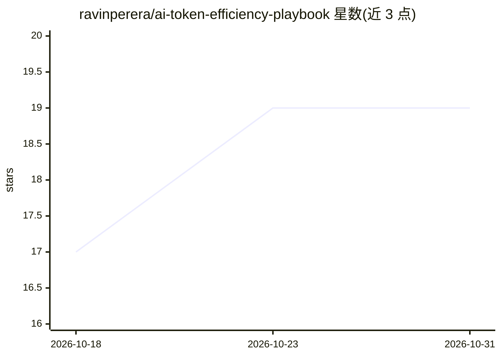

# ravinperera/ai-token-efficiency-playbook

⭐ 19 · Python · 推送 2026-10-30 · [GitHub](https://github.com/ravinperera/ai-token-efficiency-playbook) · 个人维护

**降低 AI 编程代理 token 消耗的即用指令与工作流手册**

面向使用 Codex、Claude Code、GitHub Copilot、Cursor、Gemini 等 AI 编程代理的开发者：提供可安装的指令适配文件（AGENTS.md/CLAUDE.md 等）、规范指南、检查清单与轻量脚本，核心主张为上下文卫生与模型分层路由。含 token 卫生检查脚本、上下文大小估算器与基准测量模板。README 明确声明这是概念性概览，基准是协议与夹具，非经实证的节省结果；基准数据不含已验证的实际模型节省。

## 筛选速览

| 维度 | 判定 | 备注 |
|---|---|---|
| AI 角色 | `ai-knowledge` | 知识聚合/清单类 |
| 许可风险 | `none` | — |
| 部署形态 | `library` | 以包/库形式分发 |
| 模型依赖 | — | README 未给出锁定关系 |
| 硬件要求 | — | 无带数字的原话,不猜 |
| 安装摩擦 | `low` | 无编译、无系统依赖或容器化 |
| 成熟度 | — | 结构信号不足 |

## 能力要点

- 五类代理指令适配文件一键安装（拒绝覆盖已有文件）
- 规范规则集中于 guidelines/，工具文件为薄适配层
- token 卫生检查脚本可在本地与 CI 运行
- 提供模型能力分层路由决策模板与多任务基准测量模板

## 适用场景

- 为我的 AI 编程代理配置省 token 的指令文件
- 在 CI 中检查提交的指令文件与日志是否符合 token 卫生阈值
- 按任务风险选择最低够用的模型层级以控制成本

## 场景标签

`提示工程` · 领域:Agent 开发

## 证据(README 行号)

> L5: Drop-in instructions, prompts, examples, and lightweight checks to reduce wasted AI tokens across Codex, Claude Code
> L51: |Task|Canonical guidance|Reproducible record or comparison|
> L63: The benchmarks are protocols and fixtures, **not verified live model savings**. See `CHANGELOG.md` for changes and 

## 星数曲线

2026-10-18 17 → 2026-10-31 19（+2）

---
*卡片 v1 · prompt 1.4 · 生成 2026-10-28 · 置信度 mid · 依据 README sha `24d6242907f4` · [字段定义](../../DATASET.md)*
