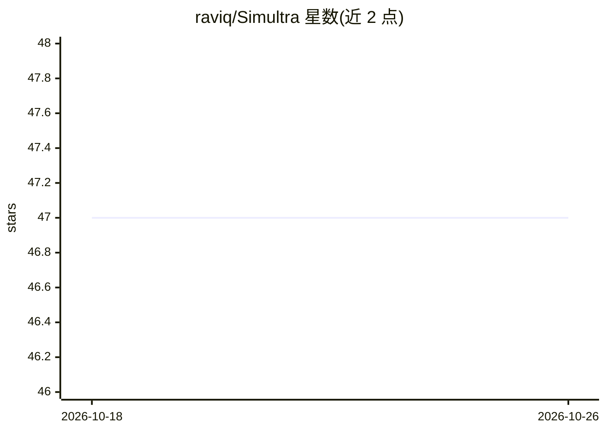

# raviq/Simultra

⭐ 47 · C++ · GPL-3.0 · 推送 2026-03-20 · [GitHub](https://github.com/raviq/Simultra) · 个人维护

**基于多智能体的混合道路交通仿真器（Qt/C++ + OSM）**

开源道路交通仿真器，将微观（agent 级物理仿真：路口、变道）与介观（事件驱动的大区域高效仿真）两种模型合并到单一多智能体框架，由混合引擎处理并发与尺度切换。支持可编程车辆/驾驶员/信号灯行为、读取 OpenStreetMap 真实路网渲染仿真、叠加降水雷达图层。需用 qmake/make 从源码编译，依赖 Qt 5.11.2+、C++11、Readosm、MapGraphics；通过 XML 配置文件定义路网拓扑与仿真场景，GUI 提供交互控制。曾被适配部署于分布式研究项目与 StarBED 测试床，附 AAMAS 2016 论文引用。

## 筛选速览

| 维度 | 判定 | 备注 |
|---|---|---|
| AI 角色 | `ai-enhanced` | 去掉 AI 部分产品仍成立 |
| 许可风险 | `viral` | GPL-3.0 |
| 部署形态 | `None` |  |
| 模型依赖 | — | README 未给出锁定关系 |
| 硬件要求 | — | 无带数字的原话,不猜 |
| 安装摩擦 | `low` | 无编译、无系统依赖或容器化 |
| 成熟度 | — | 结构信号不足 |

## 能力要点

- 微观与介观混合仿真引擎，面向大规模真实路网的实时仿真
- 可编程 agent 仿真车辆、驾驶员与智能交通信号行为
- 读取 OpenStreetMap 路网渲染仿真，支持降水雷达图层叠加
- GUI 提供播放/暂停、物理视图、行人模式等约 20 项交互控制

## 适用场景

- 在真实城市路网上做大规模交通流与拥堵仿真
- 研究多智能体微观/介观混合交通建模方法
- 为分布式系统研究提供交通仿真测试组件

## 场景标签

 · 领域:交通仿真/复杂系统

## 证据(README 行号)

> L16: Simultra is an open-source road traffic simulator that seamlessly combines **microscopic** and **mesoscopic** simul
> L24: - 🚗 **Programmable agents** — emulate vehicles, drivers, and intelligent traffic signals with configurable behavior

## 星数曲线

2026-10-18 47 → 2026-10-26 47（+0）

---
*卡片 v1 · prompt 1.4 · 生成 2026-10-25 · 置信度 mid · 依据 README sha `768ea9613d99` · [字段定义](../../DATASET.md)*
