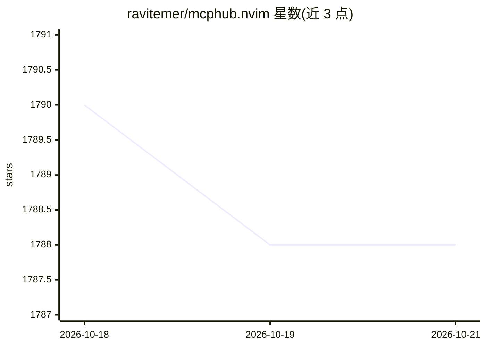

# ravitemer/mcphub.nvim

⭐ — · [GitHub]() · 个人维护

**Neovim 的 MCP 客户端：统一管理并接入 MCP 服务器到聊天插件**

用 Lua 编写的 Neovim 插件，作为 MCP（Model Context Protocol）客户端运行：集中管理本地（STDIO）与远程（Streamable-HTTP/SSE）MCP 服务器，支持 OAuth 与 Header 认证，提供 Tools、Resources、Resource Templates、Prompts 能力（Roots 与 Sampling 不支持）。它与 Avante.nvim、CodeCompanion.nvim、CopilotChat.nvim 三类聊天插件集成，把 prompts 暴露为斜杠命令；另含 MCP 服务器市场浏览与安装、VS Code 风格配置语法、Lua 原生服务器编写与热重载等机制。安装与详细指南见其文档站点，README 未给出具体安装命令。

## 筛选速览

| 维度 | 判定 | 备注 |
|---|---|---|
| AI 角色 | `ai-ecosystem` | LLM/agent 周边工具 |
| 许可风险 | `permissive` | — |
| 部署形态 | `None` |  |
| 模型依赖 | — | README 未给出锁定关系 |
| 硬件要求 | — | 无带数字的原话,不猜 |
| 安装摩擦 | `low` | 无编译、无系统依赖或容器化 |
| 成熟度 | — | 结构信号不足 |

## 能力要点

- 集中管理 MCP 服务器，支持 Tools/Resources/Prompts 与列表实时更新
- 三种传输（Streamable-HTTP/SSE/STDIO）与远程服务器 OAuth/Headers 认证
- 与 Avante.nvim、CodeCompanion.nvim、CopilotChat.nvim 集成（prompts 作为斜杠命令）
- MCP 服务器市场发现与安装、Lua 原生 MCP 服务器与 Dev 模式热重载

## 适用场景

- 在 Neovim 聊天插件中使用 MCP 服务器的工具与资源
- 统一管理多个本地与远程 MCP 服务器配置
- 浏览市场并安装经过验证的 MCP 服务器

## 场景标签

 · 领域:开发者工具/LLM 接入

## 证据(README 行号)

> L20: MCP Hub is a MCP client for neovim that seamlessly integrates MCP (Model Context Protocol) servers into your editin
> L55: ||Avante.nvim|✅|Tools, resources, resourceTemplates, prompts(as slash_commands)|

## 星数曲线

2026-10-18 1,790 → 2026-10-21 1,788（-2）

---
*卡片 v1 · prompt 1.4 · 生成 2026-10-21 · 置信度 high · 依据 README sha `dcb7f78ac27b` · [字段定义](../../DATASET.md)*
